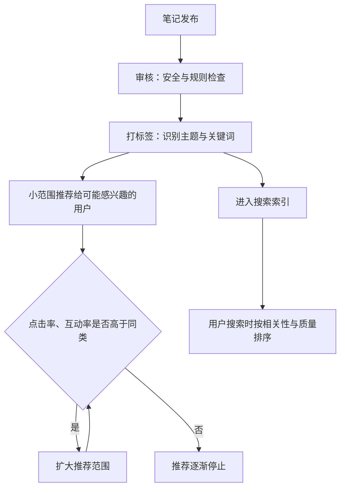

# 小红书：推荐、搜索与关键词布局

小红书的一篇笔记有两种被看到的方式：在「发现」页的双列信息流里被推荐给你，或者你主动搜了某个词、它出现在搜索结果里。两条通道的规律不一样，做法也不一样。这一章先讲清两条通道各自怎么工作（哪些是官方说法、哪些是行业经验），再讲怎么把关键词布局到一篇笔记的各个位置上。

小红书的账号身份、导流细则和「品牌名成为钥匙」的思路，《国内私域与内容平台》第 3 章已经讲过，这里不重复。

## 两条分发通道

### 推荐：双列信息流里的点击竞争

小红书首页是双列瀑布流，一屏同时显示四到六篇笔记的封面和标题。这和抖音的单列全屏有本质区别：

- **抖音**：视频直接开始播放，用户的决定是「划走还是看完」，核心是完播
- **小红书**：用户先看到封面和标题，决定「点不点」；点进去以后才是看完、点赞、收藏、评论、关注

所以小红书的推荐通道里有一个抖音没有的关卡：**封面点击率**。封面和标题决定了这篇笔记能不能拿到第一次被打开的机会。

平台没有公开推荐算法的细节。下面这个流程是行业里比较一致的理解，**不是官方文档**：



几条在创作者经验分享中比较一致的说法：

- **收藏和评论的权重高于点赞**。网上流传过一个「CES 评分」公式（点赞、收藏各 1 分，评论 4 分，转发 4 分，关注 8 分），出处不明，**小红书官方从未确认**，只能当作「评论、转发、关注比点赞更有价值」的直观理解
- **推荐流量有生命周期**。大部分笔记的推荐流量集中在发布后的头几天；搜索流量则可以持续数月
- **账号垂直度影响打标签**。一个账号长期发同一个领域，新笔记更容易被准确地推给对的人。这一点是经验说法，但和推荐系统的一般原理一致

### 搜索：被当成搜索引擎的社区

小红书的搜索比大部分人想象的重要。公开引用较多的数据：

- 超过 70% 的月活用户使用搜索（来源：小红书《十大搜索趋势洞察》2024 年上半年报告，经第三方转引，原报告未找到）
- 2024 年第四季度日均搜索量在 6 亿次左右（来源：IT 之家援引周天财经报道，**不是官方数据**）

搜索通道对创作者的意义：

1. **内容寿命变长**。一篇讲「程序员怎么选机械键盘」的笔记，只要这个问题还有人搜，它就一直有流量
2. **新号也有机会**。搜索排序看的是相关性和内容质量，不完全看粉丝数。小号的笔记如果标题和正文准确命中长尾词，排在前面并不少见
3. **流量更精准**。主动搜索的人带着明确需求来，收藏、关注的意愿比随手刷到的人高

在专业号的数据中心里，可以看到每篇笔记的流量来源（首页推荐、搜索、关注页、个人主页等，具体分类以后台为准）。**搜索流量占比逐月上升**，是你的内容开始长期工作的信号。

### 两条通道的取舍

| | 推荐通道 | 搜索通道 |
|---|---|---|
| 决定因素 | 封面点击率、互动率 | 关键词相关性、内容质量 |
| 流量形态 | 爆发快、衰减快 | 起量慢、持续久 |
| 适合的选题 | 有情绪、有共鸣、有话题性 | 有明确问题、有人在搜 |
| 标题风格 | 戳痛点、给悬念 | 包含搜索词、直接说清解决什么 |
| 对新号 | 看运气，波动大 | 更稳定，可积累 |

副业创作者的建议：**以搜索通道为底盘，用推荐通道做增量**。大部分笔记按「有人在搜」来选题和起标题，保证每篇都能长期带来一点流量；每月留一两篇做话题性更强的内容，去博推荐。

## 找到用户在搜的词

### 从搜索框挖词

最直接的工具就是小红书自己的搜索框。按下面的步骤做一张关键词表：

```text
步骤 1：写下 3–5 个核心词（你的赛道）
  例：AI 编程、程序员副业、Mac 效率、Python 入门

步骤 2：逐个输入搜索框，不要回车，记下下拉联想词
  例：「AI 编程」→ AI 编程工具推荐 / AI 编程入门 / AI 编程 cursor / AI 编程 小白

步骤 3：回车进入结果页，记下顶部的筛选标签和「相关搜索」
  这些通常是平台认为和核心词高度相关的细分词

步骤 4：对每个联想词再重复一次步骤 2
  得到三级长尾词，例：「AI 编程 小白」→ AI 编程小白怎么开始 / AI 编程小白用什么工具

步骤 5：对每个词打两个分
  需求分：联想位置靠前、结果页最近 3 个月有新笔记 → 高
  竞争分：前 20 条里大号（粉丝过 10 万）占多少 → 越多越难
```

### 关键词表模板

| 关键词 | 层级 | 需求（高 / 中 / 低） | 竞争（大号占比） | 前 20 条里的空白 | 计划笔记 |
|---|---|---|---|---|---|
| AI 编程工具 | 一级 | 高 | 15/20 | 都是工具列表，没有真实项目对比 | 暂不做 |
| AI 编程小白怎么开始 | 三级 | 中 | 4/20 | 缺少「零基础第一周做什么」 | 第 1 周 |
| cursor 和 copilot 区别 | 二级 | 中 | 7/20 | 多是半年前的对比，版本已变 | 第 2 周 |
| 程序员下班副业 | 二级 | 高 | 9/20 | 多是空泛清单，缺具体收入和耗时 | 第 3 周 |

新号优先做**三级长尾词**：需求中等、竞争低、前 20 条有明显空白。一级大词留到账号有一定权重以后再碰。

### 其他挖词来源

- **评论区的问题**：同类笔记评论区里反复出现的提问，就是没被满足的搜索需求
- **你自己的问题**：开发者遇到的「怎么在 Mac 上 xxx」「xxx 报错怎么办」，很可能也有别人在搜
- **平台的创作灵感 / 热点工具**：创作中心通常有选题推荐类功能，名称和位置会调整，以当前后台为准
- **商业工具**：蒲公英、聚光等平台有关键词和人群洞察功能，偏向品牌方使用，见《广告商单与品牌合作》《投流与数据分析》

## 关键词布局：一篇笔记的五个位置

找到关键词后，要让它出现在平台能识别的位置。一篇笔记有五个位置可以放关键词：

| 位置 | 怎么放 | 注意 |
|---|---|---|
| 标题 | 核心关键词放在前半段，用自然的句子 | 标题有字数上限（目前常见说法是 20 字，以发布页为准）；不要堆砌 |
| 正文首段 | 前两三句里再出现一次核心词或近义词 | 让平台和读者都立刻知道这篇讲什么 |
| 正文中段 | 用小标题或分段，自然覆盖 2–3 个相关长尾词 | 不要为了关键词写病句 |
| 话题标签 | 3–5 个，选和关键词一致、有一定浏览量的话题 | 不要带完全无关的热门话题 |
| 图片文字 | 封面大字和内页标题里包含关键词 | 平台可能识别图片内文字，这是行业推测，官方未确认 |

### 一个布局示例

```text
目标关键词：AI 编程小白怎么开始（主）、cursor 入门、零基础写代码（辅）

标题：AI 编程小白怎么开始？我带表妹用一周做出第一个网页

正文：
表妹完全零基础，想试试 AI 编程。我们用了一周，
从装软件到做出一个能打开的个人主页。记录一下 AI 编程小白的第一周怎么安排。

📌 第 1 天：装工具
选了 cursor，入门门槛最低……（cursor 入门的具体步骤）

📌 第 2–3 天：先学会提问
零基础写代码，最难的不是代码，是把需求说清楚……

📌 第 4–7 天：做一个真实的小东西
……

最后说两句：AI 编程不是不用学，而是学习顺序变了……
你们第一次用 AI 写代码遇到的最大问题是什么？

#AI编程 #零基础学编程 #cursor #程序员 #自学编程
```

注意几点：

- 核心词「AI 编程小白」在标题和首段各出现一次，**读起来是正常的句子**
- 辅助词「cursor 入门」「零基础写代码」在正文里自然出现，不是硬塞
- 话题标签和关键词对应，没有「#今日穿搭」这类无关热门话题
- 正文里的表情符号是小红书的常见排版习惯，用于分段，不是必需的

### 堆砌的反例

```text
标题：AI编程 AI编程工具 AI编程入门 AI编程小白 cursor教程

正文：AI编程小白必看！AI编程入门教程，AI编程工具推荐，
AI编程零基础，AI编程怎么学……
```

关键词堆砌在搜索引擎里早就是被打击的对象。小红书没有公开说明如何处理，但这样的标题点击率一定很低，读者看了也不会收藏，推荐和搜索两条通道都会失败。

## 让搜索流量持续增长

### 做系列，不做单篇

围绕一个二级关键词，用 5–10 篇笔记覆盖它下面的长尾词：

以二级关键词「程序员副业」为例，一个系列可以这样排：

1. 程序员副业有哪些（总览）
2. 程序员接私活去哪找
3. 程序员做独立开发第一年收入
4. 程序员副业要不要告诉公司
5. 程序员副业怎么交税

系列化有两个好处：账号在这个主题上的垂直度更高；读者看完一篇会点进主页看其他几篇，主页访问和关注都会提升。

### 定期更新老笔记的思路

搜索结果会随时间变化。每个月做一次「搜索排名自查」：

| 关键词 | 上月排名 | 本月排名 | 我的笔记发布时间 | 排在我前面的是什么 | 动作 |
|---|---|---|---|---|---|
| cursor 和 copilot 区别 | 5 | 14 | 4 个月前 | 两篇最近发布、版本更新的对比 | 发一篇新版本的对比 |
| 程序员接私活去哪找 | 8 | 7 | 3 个月前 | — | 不动 |

小红书笔记发布后可以编辑，但频繁大改已发布的笔记会不会影响分发，平台没有说明。稳妥的做法是：**小修小补可以编辑，内容过时就发新笔记**，在新笔记里说明「之前那篇是旧版本」。

### 用评论区补长尾

评论区的问答也是内容的一部分。有人在评论里问「Windows 也能用吗」，认真回答，这条评论本身会让笔记覆盖到「Windows」相关的搜索场景（这一点是经验推测，平台是否索引评论内容没有官方说明）。更确定的收益是：评论数提高了互动，读者觉得这个作者靠谱。

## 数据判读：笔记属于哪条通道

发出去 7 天后，看每篇笔记的流量来源结构，把笔记分成四类：

| 类型 | 特征 | 判断 | 下一步 |
|---|---|---|---|
| 推荐型 | 首页推荐占大头，前 3 天集中 | 话题性好，搜索词不明确 | 同话题补一篇带明确搜索词的 |
| 搜索型 | 搜索占比高，每天稳定有流量 | 命中了有人搜的词 | 围绕这个词做系列 |
| 双强型 | 推荐和搜索都多 | 最理想 | 拆解封面、标题、关键词，复制结构 |
| 双弱型 | 都很少 | 选题或封面有问题 | 看点击率：低就改封面标题；正常但互动低就是内容问题 |

第 9 章会更系统地讲小红书后台各项指标怎么看。

## 检查清单

发布前对照：

- [ ] 这篇笔记对应关键词表里的哪个词？
- [ ] 核心关键词出现在标题前半段了吗？读起来通顺吗？
- [ ] 正文前三句里有核心词或近义词吗？
- [ ] 话题标签 3–5 个，都和内容相关吗？
- [ ] 封面大字里有没有关键词或明确的问题？
- [ ] 搜这个关键词，我的笔记比前 5 条多给了什么（更新、更具体、更真实）？

## 常见坑

- **只追热点、不做搜索词**：热点流量来得快去得快，三个月后账号什么也没留下
- **一上来抢一级大词**：「AI」「编程」「副业」这类词，新号几乎不可能排上去，先做长尾
- **标签带无关热门话题蹭流量**：推荐给了不感兴趣的人，点击率和互动率都会很差，反过来拖累账号
- **相信付费的「排名优化」服务**：承诺把笔记刷到搜索前几名的服务，通常靠刷量或多账号互动，属于平台打击的违规营销，见第 10 章
- **把行业流传的公式当官方规则**：CES 评分、「发布后 2 小时决定命运」之类的说法都没有官方出处，参考可以，迷信不必

## 本章要点

- 小红书有推荐和搜索两条通道：推荐看封面点击率和互动，爆发快衰减快；搜索看关键词相关性和质量，起量慢但持续久
- 超过 70% 的月活用户使用搜索（小红书 2024 年报告，经转引），搜索是副业创作者的底盘
- 用搜索框联想词、结果页相关搜索、评论区提问挖关键词，做一张关键词表；新号优先做需求中等、竞争低的三级长尾词
- 关键词放在标题前半段、正文首段、正文中段、话题标签、封面大字五个位置，读起来要是正常句子
- 围绕一个二级关键词做系列；每月自查搜索排名，内容过时就发新笔记
- 算法细节平台不公开，CES 公式等流传说法没有官方确认，只作参考
