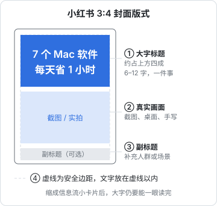

# 小红书：笔记做法、模板与变现入口

上一章讲了小红书的笔记怎么被分发，这一章讲笔记本身怎么做：图文还是视频、封面和标题怎么设计、正文怎么写，给出四套可以直接套用的模板，最后整理小红书上的变现入口在哪里、各自需要什么条件。

## 图文还是视频

小红书同时支持图文笔记和视频笔记。对副业创作者，这是第一个要做的决定。

| | 图文笔记 | 视频笔记 |
|---|---|---|
| 单篇耗时（熟练后） | 1–2 小时 | 2–5 小时 |
| 是否需要出镜 / 出声 | 不需要 | 至少要配音，出镜效果更好 |
| 收藏价值 | 高：清单、步骤、对比表一目了然 | 中：信息要看完才拿得到 |
| 搜索友好度 | 高：图内文字和正文都可被理解 | 中：主要靠标题、正文和字幕 |
| 情绪和人设 | 弱 | 强：声音、表情、语气建立信任 |
| 适合的内容 | 工具清单、教程步骤、对比测评、避坑总结 | 操作演示、开箱、vlog、观点表达 |

建议：**从图文开始**。图文的制作成本最低，最容易保持更新频率，也最贴合小红书「存起来以后用」的使用习惯。等图文跑出两三个稳定的栏目，再把其中需要演示的内容（比如软件操作）做成视频。

视频笔记的技术规格（时长上限、分辨率、画幅）会随版本调整，以发布页提示为准。竖屏 3:4 和 9:16 都很常见；横屏视频在双列信息流里封面显示较小，不建议作为主要形态。

## 封面

### 封面决定点击率

双列信息流里，读者先看到的是封面，其次才是标题。一个好封面在手机上缩成一张小卡片时，要能在一秒内让人看懂「这篇讲什么、对我有什么用」。



### 封面的五条规则

1. **比例用 3:4**（竖版），这是图文笔记在信息流里显示面积最大的比例之一
2. **大字标题 6–12 个字**，字号要大到在小卡片上能看清；不要一整段文字
3. **一张封面只讲一件事**：一个问题、一个结论或一个数字
4. **有真实的画面**：软件截图、桌面实拍、手写笔记，比纯文字海报更可信
5. **账号内保持统一风格**：固定的字体、配色、版式，主页看起来像一个系列

### 封面文案的几种写法

| 写法 | 例子 | 适合 |
|---|---|---|
| 数字 + 结果 | 「7 个 Mac 软件，每天省 1 小时」 | 清单类 |
| 问题 | 「程序员副业到底能赚多少？」 | 经验分享 |
| 对比 | 「cursor vs copilot，用了 3 个月」 | 测评 |
| 身份 + 场景 | 「后端 8 年，我的 AI 工作流」 | 个人经验 |
| 避坑 | 「接私活前，先看这 5 个坑」 | 避坑总结 |

封面里避免：「最」「第一」「神器」「100%」这类绝对化表述（《广告法》风险，详见[《自媒体与短剧合规财税》](../media-compliance/)）；与内容不符的夸张承诺（点进去发现货不对板，会拉低互动和后续推荐）。

## 标题

标题和封面大字**不要完全重复**，两者分工：

- **封面大字**：抓眼球，给出最核心的一句话
- **标题**：补充信息，并放进搜索关键词

```text
封面大字：7 个 Mac 软件，每天省 1 小时
标题：程序员 Mac 必装软件｜用了 3 年的效率清单
```

标题写法的检查点：

- 有没有包含上一章关键词表里的词
- 是不是一个正常人会说的句子
- 有没有给出「具体」：具体人群（程序员）、具体数字（3 年）、具体场景（Mac）
- 字数在发布页允许范围内（以发布页提示为准）

## 正文

### 图文笔记的正文

图文笔记的信息主要在图片里，正文起补充和搜索作用：

- **长度**：300–800 字比较常见。太短没有搜索价值，太长在手机上读不完
- **结构**：首段一句话说清场景和结论 → 分点展开 → 结尾一个开放问题
- **分段**：每段 2–3 行，段间空行；可用表情符号或「1.」「2.」做分段标记
- **关键词**：首段出现一次核心词，中段自然出现相关词

### 视频笔记的正文

视频笔记的正文常被忽略，但它是搜索的主要依据之一：

- 写清这条视频讲了什么，最好列出要点，方便不想看完视频的人先扫一眼
- 视频里提到的软件名、命令、链接说明（不放站外链接），在正文里文字化

## 四套笔记模板

### 模板一：工具清单

```text
封面：N 个 [场景] 工具，[结果]
  例：6 个 AI 工具，下班副业效率翻倍

图 2：总览表（工具名 / 用途 / 免费与否）
图 3–N：每张图一个工具：界面截图 + 一句话用途 + 一个具体用法
最后一张：我的使用顺序 / 组合建议

正文：
首段：我是做 [身份] 的，[场景] 下常用这几个工具，按 [维度] 排了一下。
分点：每个工具 1–2 行，写「什么时候用它」而不是「它有什么功能」
结尾：你们还用过什么好用的？评论区补充
标签：3–5 个
```

### 模板二：教程步骤

```text
封面：[结果]，[N] 步搞定
  例：Mac 上本地跑大模型，4 步搞定

图 2：最终效果截图（先给读者看到结果）
图 3–N：每一步一张图：步骤标题 + 截图 + 关键操作标红
最后一张：常见报错和解决

正文：
首段：适合谁、需要什么前提（系统版本、硬件）
分点：步骤文字版，命令写全
结尾：卡在哪一步可以评论区说
```

### 模板三：对比测评

```text
封面：A vs B，[时长 / 场景] 真实对比
  例：cursor vs copilot，写了 3 个月代码的结论

图 2：结论先行：一句话推荐 + 适合谁
图 3：对比表（价格、上手难度、补全质量、对话能力……）
图 4–5：同一个任务分别用 A 和 B 的截图
图 6：各自的缺点（必须有，公平才可信）

正文：
首段：我的使用背景（用了多久、做什么项目）
分点：各维度的具体体验
结尾：说明没有收任何一方的费用（如果确实没收）；如果是合作，必须按规定标注
```

最后一条很重要：如果是品牌合作内容，必须走官方合作流程并标注，见本章后面的「变现入口」和[《广告商单与品牌合作》](../brand-deals/)。

### 模板四：经验复盘

```text
封面：[身份] 做 [事情] 的第 N 个月 / 第一年
  例：下班做独立开发第 6 个月，真实收入

图 2：关键数字（收入、耗时、用户数，真实）
图 3–5：做对的 3 件事 / 踩过的 3 个坑
图 6：下一步计划

正文：
首段：一句话交代背景
分点：时间线
结尾：一个开放问题
```

复盘类笔记最打动人的是**真实的数字**。不愿意公开收入，可以公开耗时、用户数、转化率；不要编造数字，被识破会毁掉账号的信任。

## 更新节奏与栏目化

### 最小可持续节奏

| 阶段 | 频率 | 每周耗时 |
|---|---|---|
| 前 4 周 | 每周 3 篇图文 | 4–6 小时 |
| 第 5–12 周 | 每周 2–3 篇，固定两个栏目 | 3–5 小时 |
| 稳定期 | 每周 2 篇 + 每月 1 条视频（可选） | 3–5 小时 |

### 栏目化

把账号的内容固定成 2–3 个栏目，每个栏目有固定的封面版式和标题格式：

| 栏目 | 封面版式 | 频率 |
|---|---|---|
| 「工具周报」 | 蓝底白字 + 工具 logo | 每周一 |
| 「下班开发日记」 | 桌面实拍 + 日期 | 每周四 |

栏目化的好处：读者知道你下周会发什么，主页看起来整齐，你自己也不用每次从零想选题。

### 批量生产

周末花 3–4 小时做完下周的 2–3 篇，工作日只发布和回复评论：

```text
周六上午：选题（从关键词表挑）+ 写正文
周六下午：做图（用固定模板，Figma / 稿定 / Canva 等均可）
周日：检查、排期
工作日晚上：发布 + 回复评论（每天 15 分钟）
```

小红书支持定时发布（以发布页功能为准），可以提前排好。

### AI 辅助创作要标识

用 AI 生成或润色了文字、图片、视频，发布时要主动声明。小红书 2026 年 2 月 12 日发布公告，未主动标识的 AI 生成合成内容平台将**限制分发**，平台识别后还会统一加标识（来源：澎湃新闻 2026-02-13 报道「薯管家」公告）；2026 年 4 月 27 日又发布了 AI 内容治理规则，把 AI 自动运营账号、AI 造假、AI 侵权、模板化批量生产低质内容列为违规（来源：科技日报、IT 之家 2026-04-27 报道）。平台同时表示，非违规内容打上 AI 标签不影响流量。更多 AI 工具用法见[《AI 内容生产工具链》](../ai-content-pipeline/)。

## 评论区经营

小红书的评论区是内容的延伸，也是账号人设的一部分：

- **前 30 天每条评论都回**，回复要具体，不要只回「谢谢」
- **把高频问题置顶**或补在正文里
- **有价值的追问做成下一篇笔记**，并在新笔记里提到「上次有人问……」
- **遇到「求链接」「怎么联系你」**：只回答一般性信息（产品名、在哪里能搜到），不留联系方式，规则见[《国内私域与内容平台》第 3 章](../private-domain-cn/03-xiaohongshu.md)
- **批评和质疑**：先承认合理部分，再补充你的依据；不要删评、不要拉黑正常质疑的人

## 变现入口地图

小红书上创作者能接触到的变现入口如下。本书只说明入口在哪里、和内容运营的关系，具体打法见对应专书。

| 入口 | 是什么 | 门槛（以后台为准） | 详见 |
|---|---|---|---|
| 蒲公英 | 官方品牌合作平台，品牌方在这里找博主下单 | 有粉丝数和账号健康度要求，第三方文章说法从 500 到 2000 粉不等，官方当前标准未查到 | 《广告商单与品牌合作》 |
| 好物推荐 / 买手 | 在笔记或直播里挂商品，卖出后拿佣金 | 需开通相关权限 | [《带货与选品》](../ecommerce-selling/) |
| 店铺 | 自己开店卖商品 | 需主体资质 | 《带货与选品》 |
| 直播 | 直播打赏、直播带货 | 需开通直播权限 | [《直播实战》](../live-streaming/) |
| 薯条 | 给自己的笔记付费加热 | 内容需合规 | [《投流与数据分析》](../paid-traffic/) |
| 知识类商品 | 课程、咨询等 | 看品类和平台政策 | [《知识付费与私域变现》](../knowledge-products/) |

和内容运营直接相关的几点：

- **蒲公英合作必须走平台**。私下接广告、不标注商业合作，属于违规营销，小红书 2025 年起持续治理违规营销（来源：行业媒体报道，具体处罚以官方公告为准）。合作笔记会有官方标识
- **账号健康度会影响接单**。蒲公英曾推出账号健康等级，被评为「异常」的账号会被冻结接单权限（来源：行业媒体对 2022 年规则的报道，当前规则以蒲公英后台为准）。持续违规会直接断掉变现
- **商业内容占比不要太高**。经验上，接广告的笔记占比过高会让粉丝反感，也会影响自然内容的表现。很多博主会给自己定一个比例上限，比如每 4–5 篇自然笔记配 1 篇合作笔记
- **小红书禁止导流到站外交易**，所有交易应在小红书商城、直播间购物车和官方留资组件内完成（来源：《交易导流违规管理细则》，2025-03-12 起施行，光明网转载）

## 检查清单

发布每一篇笔记前：

- [ ] 封面 3:4，大字 6–12 字，缩成小卡片也能看清
- [ ] 封面和标题分工：封面抓眼球，标题含关键词
- [ ] 没有「最」「第一」「神器」等绝对化表述
- [ ] 正文首段说清场景和结论，分段短
- [ ] 图片里的截图没有泄露个人信息（手机号、邮箱、公司内部系统、他人头像）
- [ ] 用了 AI 生成或润色，已在发布时声明
- [ ] 如果是合作内容，已走官方流程并标注
- [ ] 没有任何形式的联系方式、二维码、站外链接

## 常见坑

- **封面堆满字**：小卡片上什么都看不清，等于没有封面
- **每篇封面风格都不一样**：主页像杂货铺，读者记不住你
- **对比测评只说优点**：读者会怀疑是广告，收藏率低
- **私下接广告不报备**：一次被查实，可能失去蒲公英接单资格
- **截图里带着公司代码、内网地址**：不仅泄密，还可能违反劳动合同的保密条款
- **用 AI 批量生成同质笔记**：2026 年起是平台明确打击的「AI 低质」行为

## 本章要点

- 副业创作者从图文笔记开始：成本低、收藏价值高、搜索友好；需要演示的内容再做视频
- 封面 3:4、大字 6–12 字、一张封面一件事、有真实画面、账号内风格统一
- 封面抓眼球、标题放关键词，两者不完全重复
- 四套模板：工具清单、教程步骤、对比测评、经验复盘；复盘要用真实数字
- 固定 2–3 个栏目、周末批量制作、工作日发布和回评论
- AI 参与的内容要主动声明：小红书 2026-02 起对未标识的 AI 内容限制分发
- 变现入口有蒲公英、好物推荐、店铺、直播、薯条、知识商品；合作必须走官方平台并标注，门槛以后台为准
