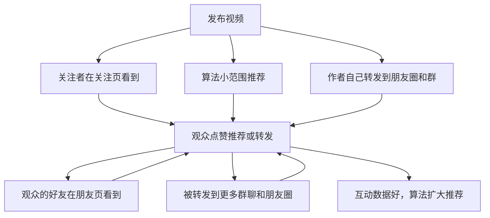

# 视频号：社交推荐与微信生态

视频号是三个平台里最「不像内容平台」的一个。它长在微信里，入口在「发现」页，和朋友圈、公众号、小程序、企业微信、微信支付共享同一套账号体系。这带来两个特点：一是**分发很大程度依赖社交关系**，二是**离私域和成交最近**。

《国内私域与内容平台》第 4 章讲过视频号的开号、认证和「视频号 → 公众号文章 → 企业微信」的导流路径。这一章从创作者角度讲：社交推荐怎么起作用、怎么利用微信生态里的其他工具放大内容、视频号的用户是谁，以及开发者在这里适合做什么。

## 社交推荐是怎么回事

### 视频号的几个入口

打开视频号，顶部通常有「关注」「朋友」「推荐」几个页签（具体名称和顺序随版本调整）：

| 入口 | 显示什么 | 对创作者的含义 |
|---|---|---|
| 关注 | 你关注的账号发的内容 | 粉丝基础流量 |
| 朋友 | 你的微信好友点过赞（「推荐」）的内容 | 社交推荐，视频号独有 |
| 推荐 | 算法根据兴趣推荐的内容 | 和抖音类似的算法分发 |

此外，视频号内容还能通过**转发到聊天、群聊、朋友圈**传播，通过**公众号文章内嵌**被看到，通过**微信搜一搜**被搜到。

### 社交推荐的链条

「朋友」页签的机制是：你的好友在一条视频下点了「推荐」（爱心或大拇指图标，界面随版本变化），这条视频就可能出现在你的「朋友」页签里，并标注「某某推荐」。这个入口最早在 2020 年 6 月的改版中出现（来源：人人都是产品经理等对视频号改版的整理）。

官方没有公开推荐算法细节。下面的链条是对公开机制的归纳，**扩散的具体阈值没有官方说明**：



社交推荐对创作者有三个直接影响：

1. **冷启动依赖你自己的微信关系**。新号的第一批观众很可能是你的好友和好友的好友。你的微信好友构成，直接影响第一波数据
2. **「推荐」按钮是公开表态**。好友点了「推荐」，他的朋友都能看到他推荐了什么。所以用户点「推荐」比在抖音点赞更谨慎：**内容要让人愿意公开为它背书**
3. **转发比点赞更值钱**。被转发进一个 300 人的行业群，可能比 1000 个陌生人刷到更有效

### 「愿意被朋友看到我推荐了它」

这句话是做视频号内容最重要的判断标准。对比一下：

| 内容 | 抖音上 | 视频号上 |
|---|---|---|
| 搞笑段子 | 点赞多 | 点「推荐」的少，怕显得无聊 |
| 擦边、低俗 | 有流量但风险大 | 几乎没人愿意公开推荐 |
| 实用知识（如「医保报销怎么操作」） | 一般 | 推荐和转发都多，觉得「对朋友有用」 |
| 行业观点（如「AI 对程序员的影响」） | 一般 | 同行愿意推荐，显得自己有见识 |
| 正能量、家国、亲情 | 一般 | 中老年用户推荐多 |

开发者能做好的是中间两类：**对朋友有用的实用知识**和**能体现见识的行业观点**。

## 视频号的用户是谁

视频号官方很少公开用户画像。可以确认的是：

- 微信官方长期不单独公布视频号的日活、月活（来源：界面新闻等对历年微信公开课的报道）
- 2023 微信公开课 PRO 上，官方说法是 2022 年视频号总用户使用时长已超过朋友圈总用户使用时长的 80%（来源：蓝鲸财经报道）
- 第三方机构的报告普遍认为视频号的中老年用户比例高于抖音、小红书、B 站，但这些报告的数据多为估算，可信度有限（例如友望数据 2025 年 1 月的报告专门研究了 40 岁及以上用户，报告自己说明数据仅供参考）

从创作者实践看，视频号上有两类人群和开发者相关：

### 职场人群（30–45 岁）

这是开发者最容易触达的人群：你的同事、同学、前同事、行业群里的人。他们关心：

- 行业变化：AI 对工作的影响、裁员与求职、技术趋势
- 职场技能：效率工具、汇报写作、管理方法
- 个人发展：副业、理财常识（注意：理财类有资质和合规要求，见《自媒体与短剧合规财税》）

### 中老年人群（45 岁以上）

这是视频号相对其他平台的特色人群。他们关心：

- 数字生活：手机怎么用、微信功能、防诈骗、AI 工具怎么用
- 健康、养生（**医疗健康类有严格的资质要求，非专业人士不要碰**）
- 家庭、传统文化、退休生活

开发者有一个独特的切入点：**给中老年人讲数字技能**。「手机字体怎么调大」「微信转账被骗了怎么办」「用 AI 帮你写拜年短信」，这类内容在视频号上传播性很强，子女也愿意转发给父母。

## 和公众号联动

公众号和视频号同属微信，可以互相导流。具体能做哪些关联，以视频号助手和公众号后台当前提供的功能为准；常见的几种做法：

| 联动方式 | 怎么做 | 作用 |
|---|---|---|
| 视频号主页关联公众号 | 在视频号资料里关联同主体的公众号 | 观众从主页进公众号 |
| 视频附带公众号文章链接 | 发布视频时添加扩展链接（以发布页可选项为准） | 视频讲结论，文章讲细节 |
| 公众号文章插入视频号视频 | 在公众号编辑器里插入视频号内容 | 文章读者顺便看视频，带动视频号互动 |
| 公众号文章插入视频号直播预约 | 直播前在文章里放预约卡片 | 给直播攒预约 |

一个常用的组合打法：**一个主题，视频号出短视频讲结论，公众号出长文讲方法**。

```text
主题：程序员怎么用 AI 写周报

视频号（90 秒）：
- 开头：「周报每周花我 1 小时，现在 10 分钟。」
- 中间：演示一次完整的操作，录屏 + 口播
- 结尾：「完整的提示词模板和三个变体，我写在公众号文章里了。」
- 扩展链接：挂公众号文章

公众号文章（3000 字）：
- 完整的提示词模板
- 不同岗位的三个变体
- 常见问题
- 文中插入那条视频号视频
```

两边的数据互相拉动：视频号带来文章阅读，文章读者回头给视频点推荐。

## 和朋友圈、社群联动

### 自己转发：冷启动的第一推

视频号新号的第一波流量，很大程度取决于你自己有没有转发。可以：

- **转发到朋友圈**：配一句真实的话，不要只发「新作品，求支持」
- **转发到相关的群**：只转发到这个内容对群成员有用的群；在技术群里转技术内容，在家族群里转给父母的数字技能内容
- **私发给特定的人**：内容里提到了某个朋友的经验、某个同事的问题，直接发给他

**不要做**：在所有群里刷屏、求点赞、互赞群。互赞群里的人对你的内容不感兴趣，他们的点赞会让算法把内容推给错误的人群，后续数据反而更差；有组织的互赞互刷也属于平台打击的数据造假，见第 10 章。

### 朋友圈的文案

```text
不好的写法：
新视频，大家帮忙点个赞🙏

好一点的写法：
帮我妈把手机字体调大以后，她终于不用眯着眼看消息了。
录了个 1 分钟的教程，家里有长辈的可以转给他们。
```

后者给了朋友一个转发的理由：**对他有用，或者对他的家人有用**。

## 和私域的距离

视频号离企业微信、个人微信最近，这是它对知识付费、咨询、课程类创作者最大的价值。但导流规则在收紧：

- 视频号主页和直播间配置「添加企业微信」的功能已不再对新配置开放（详见《国内私域与内容平台》第 4 章的整理，该书引用的是私域运营媒体的报道，原公告日期未查到）
- 视频号同样不鼓励在视频画面、评论里直接放联系方式，具体以视频号相关运营规范为准
- 目前比较稳的路径仍然是：**视频号 → 公众号文章 → 文末企业微信二维码**

知识付费产品的设计、定价和私域运营，见《知识付费与私域变现》。

## 开发者适合做的选题

| 方向 | 选题示例 | 目标人群 | 被转发的理由 |
|---|---|---|---|
| AI 工具实用技巧 | 「用 AI 三分钟做完一份会议纪要」 | 职场人 | 对同事有用 |
| 行业观察 | 「AI 写代码以后，初级程序员还招吗」 | 程序员、IT 从业者 | 体现见识 |
| 给长辈的数字技能 | 「教爸妈识别 AI 换脸诈骗」 | 中老年及其子女 | 关心家人 |
| 职场效率 | 「周报、日报、汇报，三个模板通用」 | 职场人 | 实用 |
| 程序员日常 | 「35 岁程序员的一天」 | 同行、好奇的人 | 共鸣 |

不太适合的：纯技术教程（在视频号上搜的人少，更适合 B 站）、需要长时间看完的深度内容（视频号用户刷视频的习惯更接近抖音）。

## 第一个月的执行步骤

```text
第 1 周：准备
□ 用个人微信开通视频号，账号名和公众号（如果有）保持一致
□ 写简介：身份 + 讲什么 + 更新频率
□ 列出 20 个选题，按「愿不愿意被朋友看到我推荐了它」筛一遍，留 10 个

第 2 周：发前 2 条
□ 每条 60–90 秒，竖屏
□ 发布后转发到朋友圈（配真实文案）和 1–2 个相关的群
□ 记录：播放、推荐数、转发数、新增关注

第 3 周：发 2 条，开始联动
□ 如果有公众号，其中 1 条配一篇长文，互相挂链接
□ 观察哪条被陌生人（非好友）转发了

第 4 周：发 2 条，复盘
□ 对比 6 条视频：哪条的转发 / 播放比最高？
□ 下个月多做转发率高的那一类
```

## 常见坑

- **只靠自己转发**：前几条可以，长期靠刷自己的朋友圈，朋友会屏蔽你
- **在所有群里发链接求赞**：既打扰别人，又让算法推给错误人群
- **内容让朋友不好意思推荐**：太营销、太低俗、太自夸的内容，社交推荐链条第一环就断了
- **把视频号当成主要导流工具，却不做公众号**：视频号直接加企业微信的路径已经收紧，没有公众号这一层会很被动
- **碰医疗、理财等需要资质的领域**：视频号用户中长辈多，这类内容一旦出问题，平台处罚和法律风险都更重

## 本章要点

- 视频号有关注、朋友、推荐三种主要入口，「朋友」页签的社交推荐是它独有的
- 冷启动依赖你自己的微信关系；好友的「推荐」是公开表态，转发比点赞更值钱
- 判断标准：「观众愿不愿意被朋友看到他推荐了这条」；实用知识和行业观点最适合开发者
- 视频号用户规模官方不公布；职场人群和中老年人群是开发者能切入的两类，给长辈讲数字技能是特色方向
- 和公众号组合：视频讲结论、文章讲方法，互相挂链接
- 自己转发到朋友圈和相关群做冷启动，配真实文案，不刷屏不互赞
- 去私域的稳定路径是「视频号 → 公众号文章 → 企业微信」
