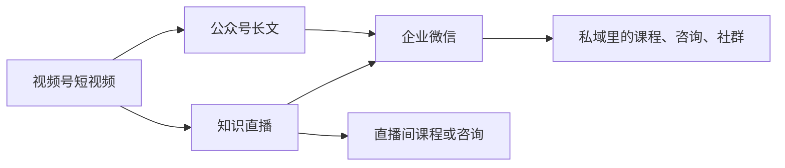

# 视频号：内容做法、直播与变现入口

上一章讲了视频号的社交推荐和微信生态联动，这一章讲具体的内容怎么做、直播在视频号上的特殊地位，以及视频号上有哪些变现入口。

## 内容形态

### 画幅和时长

视频号同时支持竖屏和横屏视频，时长上限和分辨率要求以视频号助手的发布页说明为准。从创作实践看：

| 形态 | 时长 | 适合 | 说明 |
|---|---|---|---|
| 竖屏短视频 | 30 秒–2 分钟 | 观点、技巧、日常 | 在推荐流里占满屏幕，最主流 |
| 竖屏中视频 | 2–5 分钟 | 教程、讲解 | 需要更强的开头留人 |
| 横屏视频 | 3 分钟以上 | 从 B 站、公众号转来的长内容 | 在竖屏流里显示较小；适合被转发到群里看 |
| 图片轮播 | — | 图文清单 | 视频号支持图片内容，适合把公众号要点做成卡片 |

对开发者的建议：**以 60–120 秒的竖屏为主**。视频号用户的刷视频习惯接近抖音，太长的内容完播困难；但它比抖音更能容忍「说清楚一件事需要 90 秒」的节奏。

### 三种低成本做法

[《国内私域与内容平台》第 4 章](../private-domain-cn/04-wechat-oa-channels.md)列过录屏讲解、图文轮播、实拍、直播答疑四种形式。这里补充每种做法的具体脚本结构。

#### 口播 + 字幕（需要出镜）

```text
【0–3 秒】结论或冲突，直视镜头
「我用 AI 写周报，从 1 小时变成 10 分钟。」

【3–15 秒】交代背景
「我是做后端的，每周五都要交周报，以前要翻一周的提交记录、会议纪要……」

【15–60 秒】方法，分 3 步
「第一步……第二步……第三步……」（每一步配画面切换或字幕卡）

【60–80 秒】一个限制或提醒
「注意，公司的代码和敏感信息不要往外部 AI 工具里贴。」

【80–90 秒】收尾
「完整的提示词放在公众号文章里了。」
```

#### 录屏 + 配音（不出镜）

```text
【0–3 秒】先放最终效果的画面，配一句结论
画面：AI 生成的完整周报
配音：「这份周报，AI 帮我 10 分钟写完。」

【3–60 秒】完整操作录屏，关键步骤放大、加字幕
不要录鼠标乱晃的过程，剪掉等待时间

【60–75 秒】回到效果画面，总结
配音：「三步：喂材料、给模板、人工改。」
```

#### 图片轮播（不出镜不出声）

```text
图 1：标题卡「给爸妈手机做的 5 个设置」
图 2–6：每张一个设置：截图 + 大字说明
图 7：总结卡「转给家里的长辈」
配乐：选视频号音乐库里的音乐，避免版权问题
```

### 原创声明

视频号发布时可以声明原创。声明原创是参与部分平台激励的前提（例如下文的创作分成计划，2023 年推出时要求开启原创声明）。

- **只对自己的原创内容声明原创**。搬运、二次剪辑他人内容并声明原创，属于侵权和违规，见第 10 章
- 用了 AI 生成的画面或配音，按平台要求做 AI 内容标识（国家《人工智能生成合成内容标识办法》2025 年 9 月 1 日起施行，各平台都在落实），详见[《AI 内容生产工具链》](../ai-content-pipeline/)和[《自媒体与短剧合规财税》](../media-compliance/)

### 标题与话题

视频号的视频描述（文案）会显示在视频下方，也是搜一搜的检索依据之一：

- **第一行写清楚这条讲什么**，包含人会搜的词：「AI 写周报」「手机字体调大」
- **带 2–3 个话题**（#话题），选和内容相关的
- **不要写成长文**，两三行足够；需要长文就挂公众号文章

## 直播在视频号上的位置

### 为什么视频号重视直播

在视频号上，直播的地位比在小红书、B 站更高：

- **直播有微信生态的预约和提醒**：观众可以预约直播，开播时会收到提醒；预约入口可以放在视频、公众号文章里
- **直播可以被转发到群聊**，熟人带熟人进直播间
- **直播是视频号变现的主要场景之一**：打赏、带货、卖课都在直播间里完成

### 开发者的直播形式

对开发者，适合视频号的直播不是带货，而是**知识直播**：

| 形式 | 做法 | 频率 |
|---|---|---|
| 主题分享 | 讲一个主题 30–45 分钟，再答疑 15 分钟 | 每月 1–2 次 |
| 实操演示 | 共享屏幕，现场做一个小项目 | 每月 1 次 |
| 答疑 | 收集观众问题，逐个回答 | 配合短视频选题 |
| 连麦对谈 | 和同行连麦聊一个话题 | 偶尔 |

直播的话术、排品、场控、复盘，见[《直播实战》](../live-streaming/)。这里只给一个和视频号生态结合的预热流程：

```text
直播前 7 天：
□ 视频号发布一条短视频，内容是直播主题的「预告片」，挂直播预约
□ 公众号发一篇文章，插入直播预约卡片

直播前 1 天：
□ 朋友圈发预告，附预约链接
□ 在相关的群里发一次（只在这个主题对群成员有用的群）

直播当天：
□ 开播前 30 分钟朋友圈再提醒一次

直播后：
□ 把直播的精华片段剪成 2–3 条短视频
□ 公众号写一篇直播回顾
```

### 关于无人直播和录播

用录播冒充实时直播、用 AI 数字人长时间无人值守直播，在多个平台都有限制或明确的规则要求，存在被判定违规的风险。具体风险分析见《直播实战》。

## 变现入口

视频号的变现入口比较分散，而且规则调整频繁。下表是公开资料里能确认的入口，**门槛大多来自 2023 年前后的报道，当前条件请以视频号助手的「创作者服务」「变现」相关页面为准**。

| 入口 | 是什么 | 公开资料中的条件 | 详见 |
|---|---|---|---|
| 创作分成计划 | 原创视频评论区展示广告，创作者获得分成 | 2023 年推出时：有效粉丝 100 及以上、内容合规、优质原创，分批邀请；仅对个人号开放；需开启原创声明 | 本节 |
| 互选平台 | 微信官方的品牌合作平台，品牌方找创作者下单 | 2023 年的报道称万粉以上的认证账号可入驻 | [《广告商单与品牌合作》](../brand-deals/) |
| 商品橱窗 / 带货 | 在视频、直播里挂商品，卖出得佣金 | 条件以视频号小店 / 带货中心为准，第三方说法不一 | [《带货与选品》](../ecommerce-selling/) |
| 视频号小店 | 自己开店卖商品 | 需主体资质 | 《带货与选品》 |
| 直播打赏 | 观众在直播间送礼物 | 需开通直播权限 | 《直播实战》 |
| 付费内容 / 课程 | 付费直播、付费订阅、课程等 | 以后台当前提供的功能为准 | [《知识付费与私域变现》](../knowledge-products/) |
| 加热 | 付费给视频加热，获得更多曝光 | 内容需合规 | [《投流与数据分析》](../paid-traffic/) |

### 创作分成计划的细节

公开报道中，创作分成计划的规则（来源：人人都是产品经理 2023-04-17 文章，引用微信公开课说明）：

- 广告展示在原创视频的评论区，形式类似公众号的流量主
- 收益与视频质量、播放、投稿数量、广告行业等因素有关，平台未公布具体算法
- 上半月收入次月 1 日结算，下半月收入次月 15 日结算，可提现到微信零钱

这类广告分成对小号的收入贡献通常很小，**不要把它当作主要收入来源**。它的意义更多在于：它是平台认可你是「优质原创作者」的一个信号。

### 粉丝阶段与功能

2023 年的公开资料把视频号创作者的变现功能按粉丝阶段划分（来源：同上）：

| 阶段 | 开放的功能（2023 年资料） |
|---|---|
| 新人 | 商品橱窗、直播带货、直播打赏 |
| 百粉 | 视频变现任务、创作分成计划 |
| 千粉 | 视频商品分享 |
| 万粉 | 互选平台 |

这张表只用于理解「功能随账号成长逐步开放」的思路，具体数字以当前后台为准。

### 视频号变现的现实路径

对副业开发者，视频号上比较现实的变现组合是：



视频号本身的广告分成和带货收入，对知识类开发者通常不是主力；主力是**通过视频号建立信任，在直播间或私域里卖知识产品**。这条路径的产品设计和定价见《知识付费与私域变现》。

## 内容规划模板

以「AI 工具 + 职场效率」为方向，一个月的视频号内容规划：

| 周 | 短视频 1 | 短视频 2 | 配套 |
|---|---|---|---|
| 1 | AI 写周报（录屏） | AI 时代程序员还要学什么（口播观点） | 公众号：周报提示词模板 |
| 2 | 会议纪要 3 分钟整理（录屏） | 给爸妈的 AI 防诈指南（图片轮播） | — |
| 3 | 用 AI 做 PPT 的正确顺序（录屏） | 直播预告片 | 公众号：直播预约 |
| 4 | 直播精华片段 1 | 直播精华片段 2 | 直播：AI 办公工具答疑 45 分钟 |

## 检查清单

发布每条视频号前：

- [ ] 开头 3 秒有结论、冲突或最终效果的画面
- [ ] 竖屏为主，字幕清晰，关键操作放大
- [ ] 文案第一行包含能被搜到的词，带 2–3 个相关话题
- [ ] 原创内容声明原创；非原创内容不声明
- [ ] AI 参与的内容已按要求标识
- [ ] 画面和文案里没有联系方式、二维码
- [ ] 要挂公众号文章的，文章已发布，链接正确
- [ ] 自问：观众愿意让朋友看到他推荐了这条吗？

## 常见坑

- **直接把 B 站横屏长视频原样发视频号**：在竖屏流里显示小、节奏慢，完播很差；要按第 8 章的清单改造
- **追求创作分成收入**：小号的分成收入通常很少，把精力放在内容和私域转化上
- **直播没有预热**：视频号直播的观众主要来自预约和社交转发，不预热基本没人
- **在直播间留个人微信号**：违反平台规则，见第 10 章；走公众号和企业微信的正规路径
- **把门槛表当作现行规则**：视频号的功能开放条件调整频繁，所有数字以后台为准

## 本章要点

- 视频号以 60–120 秒竖屏为主；口播、录屏配音、图片轮播三种做法各有脚本结构
- 原创内容声明原创，AI 参与的内容按规定标识；文案第一行写清主题、带相关话题
- 直播在视频号的地位高：有预约提醒、能转发进群；开发者适合做知识直播，预热靠视频预告、公众号预约卡片和朋友圈
- 变现入口有创作分成、互选、橱窗带货、小店、打赏、付费内容、加热，门槛多为 2023 年资料，以后台为准
- 对知识类开发者，视频号的主要价值是建立信任，再在直播间或私域里卖知识产品
