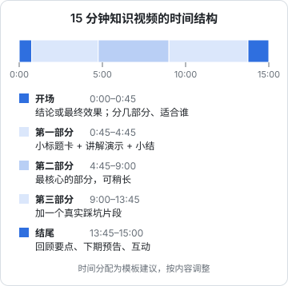

# B 站：中长视频、分区与社区文化

B 站是三个平台里对开发者最友好的一个：科技、知识类内容是它的主场，用户愿意看 10–30 分钟的视频，好的教程可以被搜索好几年。代价是制作成本最高，社区文化也最独特，用错了方式会被观众直接在弹幕和评论里指出来。

这一章讲 B 站的分发方式、中长视频的结构、分区与投稿设置、弹幕和社区文化。下一章专门讲技术区、知识区的打法和 UP 主的变现方式。

## B 站的分发方式

### 几个基本数字

B 站是上市公司，按季度公布运营数据。2025 年第三季度（来源：B 站 2025 年 Q3 财报，扬子晚报网等 2025-11-13 报道）：

- 日均活跃用户 1.17 亿，月均活跃用户 3.76 亿
- 用户日均使用时长 112 分钟
- 2025 年前三季度，近 250 万 UP 主通过广告、直播、充电、课堂、小店等渠道获得收入
- AI 相关内容的播放时长同比增长近 50%

日均 112 分钟的使用时长，说明 B 站用户有耐心看长内容，这是中长视频能在 B 站生存的基础。

### 流量从哪里来

一条 B 站视频的流量来源大致有这几种（后台的分类名称以创作中心为准）：

| 来源 | 说明 | 特点 |
|---|---|---|
| 首页推荐 | 首页双列推荐流 | 最大的流量来源，靠封面标题点击率和观看数据 |
| 播放页相关推荐 | 看完一个视频后，右侧或下方推荐的相关视频 | 和同类热门视频「挂」在一起，适合系列内容 |
| 搜索 | 用户主动搜索 | 教程类内容的长期流量来源 |
| 关注动态 | 粉丝在动态页看到更新 | 粉丝基础流量，B 站用户有追更习惯 |
| 分区页 / 热门 / 排行 | 分区浏览、热门榜单 | 头部内容的额外曝光 |
| 站外 | 被分享到微信、QQ 等 | — |

和小红书类似，B 站首页也是**双列封面流**（在手机 App 上），封面和标题决定点击。和小红书不同的是，B 站的**播放页相关推荐**很重要：如果你的视频和某个热门视频主题相近，就有机会出现在它的推荐列表里，长期获得流量。

### 推荐看什么

B 站没有公开推荐算法细节。从创作者实践和公开分享看，以下数据被普遍认为重要（**经验说法，非官方**）：

- **点击率**：封面标题能不能让人点进来
- **平均观看时长 / 观看完成度**：点进来的人看了多久
- **互动**：点赞、投币、收藏、评论、弹幕、分享
- **「一键三连」**：同时点赞、投币、收藏，是 B 站特有的高强度认可

B 站的「投币」是一个特殊的互动：用户的硬币数量有限，投币代表真正的认可。高投币率的视频通常是质量被认可的内容。

## 中长视频的结构

### 为什么结构更重要

一条 60 秒的短视频，靠开头钩子和节奏就能让人看完。一条 15 分钟的视频，观众随时可能离开，需要**结构**让他知道「接下来讲什么、还剩多少、为什么值得看下去」。



### 一条 15 分钟知识视频的模板

```text
【0:00–0:45】开场
- 0–10 秒：最核心的结论或最终效果，不要寒暄
  「这期视频结束时，你会在自己电脑上跑起一个能回答你代码库问题的本地 AI 助手。」
- 10–45 秒：这期讲什么、分几部分、适合谁
  「分三部分：环境准备、索引代码库、接入编辑器。需要你会基本的命令行。」

【0:45–4:45】第一部分
- 小标题卡（画面上显示「01 环境准备」）
- 讲解 + 演示
- 结尾一句小结，自然过渡到下一部分

【4:45–9:00】第二部分
- 同上；这是最核心的部分，可以稍长

【9:00–13:45】第三部分
- 同上；放一个「踩坑」片段，比如真实遇到的报错和解决

【13:45–15:00】结尾
- 30 秒回顾三部分要点
- 下期预告或系列中的下一集
- 自然的互动引导：「你们在用哪个本地模型？弹幕说一下」
```

### 章节和分 P

B 站提供了把长内容分段的工具，名称和入口以投稿页为准：

- **章节（分段章节）**：在一个视频的进度条上标注章节，观众可以直接跳到感兴趣的部分。中长教程**强烈建议加**
- **分 P**：一个稿件包含多个视频，适合「第 1 集、第 2 集」这样的系列课程
- **合集**：把多个独立稿件归到一个合集里，观众在播放页能看到整个系列

经验上，**15 分钟以内用章节，系列课程用合集**。分 P 对新观众的可发现性较弱，因为推荐和搜索主要展示第一个 P。

### 开头 45 秒的检查

中长视频最容易流失观众的是开头。检查：

- [ ] 前 10 秒有没有说出这期的结果或核心结论？
- [ ] 有没有用超过 15 秒的片头、自我介绍、「大家好我是 xxx」？
- [ ] 有没有说清楚适合谁、需要什么前置知识？（错的观众早点离开，对数据反而好）
- [ ] 有没有告诉观众这期分几部分？

## 封面与标题

### B 站封面

- **比例 16:9 横版**为主（竖屏视频的封面规则以投稿页为准）
- **大字标题 + 画面主体**：画面可以是你本人、软件界面、最终效果
- **在手机双列流里缩成小图后仍然能看清**：字不要多，对比要强
- B 站用户对「标题党封面」容忍度低，封面承诺的东西视频里必须有

### B 站标题

B 站标题比小红书长，可以容纳更多信息（字数上限以投稿页为准）。常见写法：

| 写法 | 例子 |
|---|---|
| 结果 + 方法 | 「10 分钟在本地跑起代码库问答助手｜Ollama + 开源 Embedding 完整教程」 |
| 系列 + 集数 | 「【从零写一个数据库】第 3 集：B+ 树的插入与分裂」 |
| 真实经历 | 「我用 AI 写了一个月代码，说说真实感受」 |
| 对比测评 | 「三款 AI 编程工具横评：同一个需求，谁写得更好」 |

技术类标题里放**具体的技术名词**（Ollama、B+ 树、Rust），这些是搜索词，也是筛选观众的信号。

## 分区与投稿设置

### 分区

投稿时要选择分区。分区影响视频出现在哪些分区页面、和哪些视频一起被推荐。

关于分区结构：据萌娘百科等非官方资料，B 站在 2025 年 3 月取消了投稿时的二级分区选择，目前一级分区有三十多个，包括科技数码、知识等（**这一点未查到官方公告，以投稿页当前选项为准**）。

开发者常用的分区方向：

| 内容 | 常见分区方向 |
|---|---|
| 编程教程、开发记录、技术讲解 | 科技 / 知识相关分区 |
| 数码产品、电脑配件评测 | 科技数码相关分区 |
| 职场经验、行业观察 | 知识相关分区 |
| 程序员日常 vlog | 生活相关分区 |

选分区的原则：**选你的目标观众会去逛的那个**。同一个账号的内容尽量集中在一两个分区。

### 标签

投稿时可以添加标签。经验做法：

- 5–10 个标签，包含**技术名词**（Python、Docker）、**内容类型**（教程、入门）、**场景**（程序员、自学）
- 可以参与投稿页推荐的相关活动话题，有时有额外曝光（以活动规则为准）

### 简介

视频简介写清楚：

- 这期讲了什么（一两句话）
- 章节时间点（如果没有用章节功能）
- 用到的软件、版本、参考资料的名称
- 代码仓库：B 站对站外链接的规则以社区规范为准；放开源代码仓库地址在技术区是常见做法，但不要放任何导流到私域、交易的链接

### 自制与转载

投稿时要选择「自制」还是「转载」。**只有你自己制作的内容才能选自制**。搬运他人视频声明自制是 B 站重点打击的行为，见第 10 章。

## 弹幕与社区文化

### 弹幕是内容的一部分

弹幕是 B 站最独特的东西。对创作者来说：

- **弹幕是实时的反馈**：哪里讲得好（「懂了」「学到了」）、哪里讲错了（「这里不对吧」）、哪里没讲清楚（「没看懂」），都会在对应时间点出现
- **弹幕让视频「活」起来**：观众觉得在和别人一起看，愿意看得更久
- **弹幕数是互动指标之一**

利用弹幕：

- 在视频里抛出可以用弹幕回答的问题：「你们用的是 Mac 还是 Windows？弹幕扣一下」
- 回看自己视频的弹幕，找出**集中出现「没看懂」的时间点**，下一期改进
- 对技术错误的弹幕指正，可以在评论区置顶勘误

### 社区文化：几条要懂的规矩

B 站有一套用户自发形成的社区文化。不懂这些，内容再好也容易被吐槽：

| 规矩 | 说明 | 怎么做 |
|---|---|---|
| 反感硬广 | 用户对营销内容非常敏感 | 商业合作必须明确标注；广告放在视频中段而不是开头，且时长要短 |
| 「恰饭」可以接受 | 用户理解 UP 主需要赚钱 | 坦诚说明「这期是恰饭」，反而被接受；藏着掖着被发现会掉粉 |
| 看重真诚和专业 | 知识区用户会挑错 | 讲错了就认，在评论区置顶勘误 |
| 讨厌标题党 | 封面标题和内容不符会被骂 | 封面承诺的内容必须在视频里兑现 |
| 尊重原创 | 搬运、抄袭会被挂 | 引用他人内容注明出处 |
| 社区梗 | 有大量站内梗和用语 | 自然使用可以拉近距离，但不要硬凹 |

### 评论区经营

- **置顶评论**：放勘误、补充资料、下期预告
- **认真回复技术问题**：B 站技术区的评论区常常本身就是一个问答社区
- **对恶意评论**：B 站提供了评论管理功能（精选评论、删除、拉黑等，以创作中心为准）；对正常的批评不要删，回应它

## 检查清单

投稿前：

- [ ] 前 10 秒给出结果或结论，没有冗长片头
- [ ] 15 分钟以内的视频加了章节；系列内容放进合集
- [ ] 封面 16:9，缩小后能看清，承诺的东西视频里都有
- [ ] 标题包含具体技术名词
- [ ] 分区选择目标观众会逛的分区；标签 5–10 个
- [ ] 简介写清内容、软件版本和参考资料
- [ ] 自制 / 转载选择正确
- [ ] 商业合作已标注（具体流程见《广告商单与品牌合作》）
- [ ] AI 生成的画面或配音已按规定标识

## 常见坑

- **开头 1 分钟的片头和自我介绍**：观众在这里大量流失
- **只看播放量**：B 站一条视频的价值更多看投币、收藏和平均观看时长
- **封面竖屏、横屏视频没章节**：浪费了 B 站最适合中长内容的特性
- **硬广不标注**：被观众发现后，评论区会被「恰烂钱」刷屏，还可能违反平台规则和《广告法》
- **讲错了不认**：知识区用户的信任一旦失去很难挽回

## 本章要点

- B 站用户日均使用 112 分钟（2025 Q3），愿意看长内容；流量来自首页推荐、相关推荐、搜索、关注动态等
- 中长视频靠结构留人：前 10 秒给结论，45 秒内说清分几部分和适合谁，正文分段并有小结过渡
- 15 分钟以内用章节，系列内容用合集
- 封面 16:9、标题放具体技术名词；分区选目标观众会逛的，标签 5–10 个
- 弹幕是实时反馈：找出集中「没看懂」的时间点改进下一期
- 社区文化：反感硬广但接受坦诚的恰饭、看重真诚和专业、讨厌标题党、尊重原创
