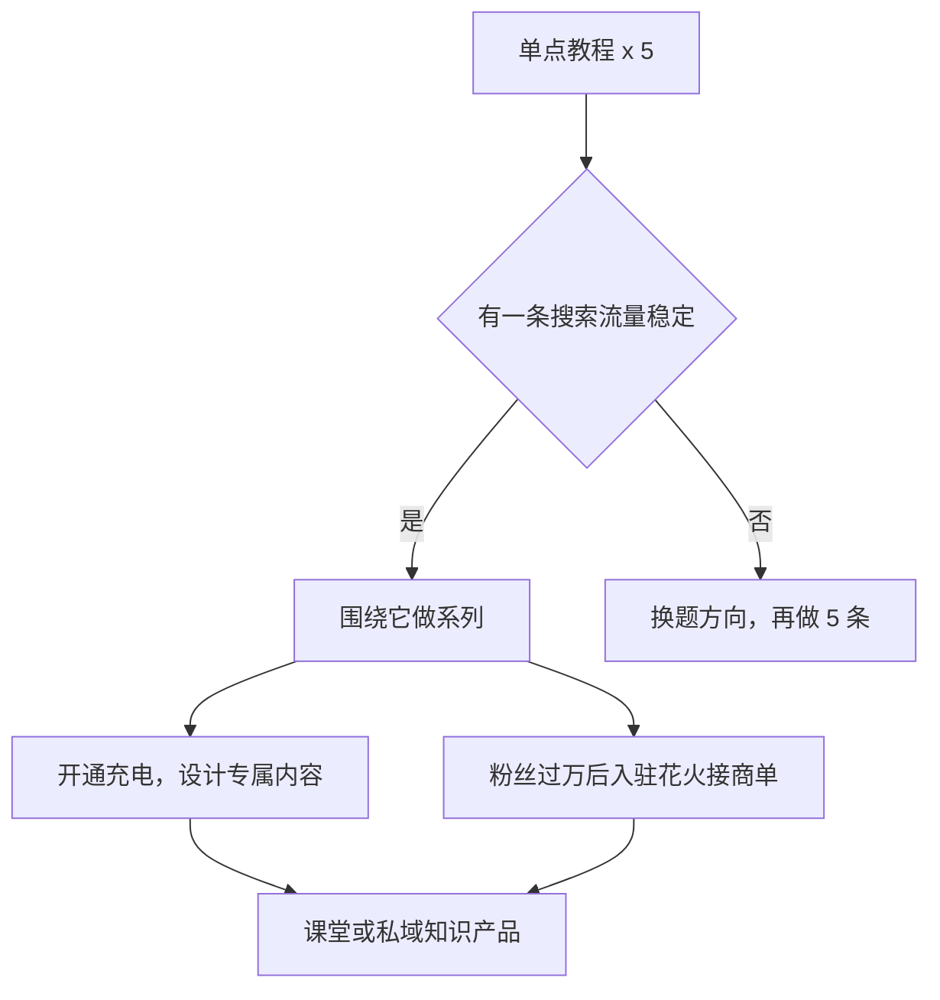

# B 站：技术区与知识区打法、UP 主变现

上一章讲了 B 站的通用规则，这一章专门讲开发者最可能做的两类内容：技术区（编程、开发、数码）和知识区（职场、行业、科普），以及 B 站 UP 主有哪些变现方式。

## 开发者在 B 站的五种内容

| 类型 | 例子 | 时长 | 制作难度 | 长期价值 |
|---|---|---|---|---|
| 系统教程 | 「从零写一个 Web 服务器」系列 | 每集 15–30 分钟 | 高 | 最高，搜索流量持续多年 |
| 单点教程 | 「Docker 部署 Next.js 的 3 种方式」 | 10–20 分钟 | 中 | 高 |
| 开发记录 | 「下班做独立开发第 6 个月」 | 10–20 分钟 | 中 | 中，建立人设 |
| 工具测评 | 「三款 AI 编程工具横评」 | 10–15 分钟 | 中 | 中，时效性强 |
| 技术科普 | 「为什么数据库要用 B+ 树」 | 8–15 分钟 | 中高（需要做动画） | 高 |

建议**从单点教程开始**：选一个具体问题，做一条 10–15 分钟的视频。它的制作成本可控，搜索流量稳定，也能让你熟悉录屏、剪辑、配音的整套流程。系统教程是长期目标，等你确认能稳定更新后再开始。

## 技术教程怎么做

### 选题：找「有人搜但没讲好」的问题

```text
步骤 1：列出你最近工作中解决过的 10 个技术问题
步骤 2：在 B 站搜索每个问题的关键词
步骤 3：看结果，判断：
  - 没有相关视频 → 可能没人搜，也可能是机会；在其他搜索引擎验证有没有人问
  - 有视频但发布超过 1–2 年 → 版本可能过时，有机会
  - 有视频但质量差（只念文档、没演示、声音差）→ 有机会
  - 有多个高质量、近期视频 → 换题，或找更细的角度
步骤 4：留下 3 个有机会的题目
```

开发者的独特优势：**你在真实工作中遇到的问题，比教程作者想象出来的问题更有价值**。「生产环境 Postgres 连接池打满怎么排查」比「Postgres 入门」更有差异化。

### 录制前的准备

技术教程最常见的问题是「录了一半发现环境有问题」。准备清单：

```text
□ 写一份逐步操作的文字稿（不是逐字稿，是步骤清单），每一步对应要执行的命令或操作
□ 在干净的环境里完整走一遍，记下所有报错和解决方法
□ 准备好最终效果，用于视频开头展示
□ 调整录屏环境：
  - 终端和编辑器字号调大（录屏后在手机上要能看清，经验上至少 18–20 号）
  - 使用高对比度主题
  - 关闭通知、隐藏书签栏和无关窗口
  - 检查屏幕上没有公司代码、密钥、内网地址、个人信息
□ 收音：用一个独立麦克风，在安静的环境录（具体设备见《拍摄与剪辑实务》）
```

### 录制和剪辑的节奏

- **分段录制**：按章节录，每段录完检查一次，出错只重录这一段
- **先录屏、后配音** 或 **边操作边讲** 都可以；新手先录屏后配音更容易控制节奏
- **剪掉所有等待**：安装依赖、编译、下载的等待时间全部剪掉或加速，画面上标注「加速」
- **放大关键区域**：在剪辑时把正在操作的代码区域放大，手机观众才看得清
- **保留真实报错**：真实遇到的报错和解决过程是教程最有价值的部分，不要剪掉

剪辑软件和具体操作见[《拍摄与剪辑实务》](../shooting-editing/)。

### 配套资料

技术教程的观众通常需要代码。常见做法：

- 把示例代码放在公开的代码托管平台，在简介里写仓库名称或地址（具体是否允许放链接、放在哪里，以 B 站社区规范为准；**只放开源代码，不放私域导流**）
- 在视频里展示完整的关键代码，观众暂停就能看清

## 知识区怎么做

知识区的内容不一定是技术，但开发者可以利用技术背景做差异化：

| 方向 | 选题示例 | 你的优势 |
|---|---|---|
| 行业观察 | 「AI 编程工具普及后，招聘需求有什么变化」 | 一线视角 |
| 职场经验 | 「程序员怎么写一份不被拒的晋升材料」 | 真实经历 |
| 技术科普给非技术人 | 「大模型是怎么『记住』对话的」 | 讲得准确 |
| 个人成长 | 「35 岁转型独立开发，第一年的账本」 | 真实数字 |

知识区观众对**准确性**要求很高。讲到你不熟悉的领域，宁可说「这部分我也不确定」，也不要编；涉及法律、医疗、金融的内容有专门的资质和合规要求，见[《自媒体与短剧合规财税》](../media-compliance/)。

### 科普视频的结构

```text
【0:00–0:30】一个反常识的问题或现象
「你跟大模型聊了 100 轮，它好像都记得。但其实，它一个字都没记住。」

【0:30–2:00】用生活类比建立直觉
「想象你每次问问题，都要把之前所有对话重新念一遍给它听……」

【2:00–8:00】逐层深入，配图或动画
上下文窗口 → token → 为什么会「忘」→ 现在的解决办法

【8:00–10:00】回到开头的问题，给出完整答案
【10:00–10:30】一个开放问题，引导弹幕和评论
```

科普视频的画面成本较高（需要图示、动画）。低成本做法：用 Keynote / PowerPoint 的动画做讲解画面，或者在白板软件上边画边讲。

## 做系列：B 站最好的复利

B 站最适合做系列。一个系列的好处：

- **合集让观众连续看**：看完第 1 集的人，播放页会显示第 2 集
- **搜索覆盖面更大**：每一集覆盖一个长尾词
- **粉丝追更**：B 站用户有追更习惯，系列让人有理由关注你

### 系列规划模板

```text
系列名：从零用 Go 写一个 Redis
目标观众：会 Go 基础语法、想理解存储系统的开发者
更新节奏：每两周一集，共 8 集

第 1 集：项目结构与 TCP 服务器（附：为什么要自己写一个 Redis）
第 2 集：RESP 协议解析
第 3 集：实现 GET / SET
第 4 集：过期时间与惰性删除
第 5 集：持久化：AOF
第 6 集：持久化：RDB
第 7 集：性能测试与优化
第 8 集：总结，和真正的 Redis 差在哪里

每集结构：上集回顾（30 秒）→ 本集目标 → 实现 → 测试 → 下集预告
```

规划时注意：**第 1 集要能独立成立**。大部分新观众是从推荐流点进第 1 集的，它要让人在不知道后续的情况下也觉得有收获。

## UP 主的变现方式

> [!WARNING]
> 下表的门槛和比例多为历史资料：创作激励是 2024-04 的版本，充电是 2023 年的报道，花火门槛是 2020 年的报道，可能都已调整；以 B 站创作中心、花火平台的当前说明为准。

B 站 UP 主的收入来源比较多元。2025 年前三季度，近 250 万 UP 主通过广告、直播、充电、课堂、小店等渠道获得收入，人均收入同比增长 22%（来源：B 站 2025 年 Q3 财报报道）。下表列出主要入口。

| 入口 | 是什么 | 公开资料中的规则 | 详见 |
|---|---|---|---|
| 创作激励 | 平台按视频数据给的激励 | 2024 年 4 月起的版本：主要面向近半年月均收入不足 5000 元的个人 UP 主，基础激励单月上限 2000 元 | 本节 |
| 充电 | 观众给 UP 主「充电」付费支持，包括包月充电和充电专属视频 | 包月充电专属视频 2023 年内测、邀请制；分成比例官方未公开确认 | 本节、[《知识付费与私域变现》](../knowledge-products/) |
| 花火 | B 站官方的 UP 主商业合作平台 | 2020 年报道的门槛：实名、18 岁以上、粉丝 ≥1 万、30 天内有原创视频等 | [《广告商单与品牌合作》](../brand-deals/) |
| 课堂 | 付费课程 | 需申请入驻，以课堂入驻说明为准 | 《知识付费与私域变现》 |
| 直播 | 打赏、带货 | 需开通直播 | [《直播实战》](../live-streaming/) |
| 带货 / 小店 | 视频、直播带货 | 以带货相关规则为准 | [《带货与选品》](../ecommerce-selling/) |

### 创作激励：不要指望它

> [!WARNING]
> 本节按界面新闻 2024-03 报道的版本（2024-04-01 起实施）整理，激励规则可能已再次调整，以 B 站创作中心激励计划的当前说明为准。

B 站的创作激励在 2022 年和 2024 年都做过大幅调整。界面新闻 2024 年 3 月报道的版本（2024 年 4 月 1 日起实施）：

- 每月初，平台根据 UP 主过去半年的收入水平判断当月是否有资格获得基础激励
- 半年平均月收入超过 5000 元的 UP 主，不再享有基础激励
- 基础激励单月上限 2000 元
- 另有活动激励，面向半年内月收入低于 2 万元的 UP 主

这个调整的方向很明确：**激励是给起步阶段创作者的补贴，不是主要收入**。

### 充电和付费内容：适合技术区

充电是 B 站对技术教程类 UP 主比较友好的变现方式：

- 观众觉得教程有用，愿意每月付一点钱支持
- 包月充电可以配合「充电专属视频」：比如系列教程的进阶部分、源码讲解、答疑直播
- 2023 年的报道提到包月充电有不同档位（其中一档为每月 30 元），专属视频处于邀请制内测（来源：IT 之家 2023 年 5 月报道）；目前的开通条件以创作中心为准

一个可行的设计：

```text
免费：系列教程主线（保证搜索流量和新观众）
充电专属：每集的扩展练习讲解、源码逐行解读、月度答疑直播
```

不要把主线内容锁进付费：B 站的增长靠免费内容的推荐和搜索，主线收费会切断新观众来源。

### 商单：技术区的主要收入

对有一定粉丝量的技术区、数码区 UP 主，**品牌合作（商单）通常是最主要的收入来源**，这和 2024 年前后行业报道中「广告和直播已成为 UP 主最重要收入渠道」的说法一致。常见的技术区商单：开发工具、云服务、AI 产品、数码硬件。

接商单要注意：

- 通过花火平台下单，视频会有官方的商业合作标识；私下接单不报备违反平台规则
- 技术区观众对「恰饭」的接受度取决于**产品和你的内容是否相关、你是否说了真话**
- 报价、brief、脚本过审、合同结算见《广告商单与品牌合作》

## 开发者的 B 站成长路径



时间预估（每周 6–8 小时）：

| 阶段 | 内容 | 时长 |
|---|---|---|
| 熟悉流程 | 5 条单点教程 | 约 2–3 个月 |
| 找到方向 | 确定一个有稳定搜索流量的主题 | 第 3–4 个月 |
| 系列化 | 一个 8 集系列 | 约 4 个月 |
| 变现 | 充电、商单 | 视粉丝增长而定 |

这个节奏比小红书和视频号都慢，但 B 站内容的寿命也最长：一个系列做完，可能在接下来几年里持续带来流量。

## 检查清单

技术教程投稿前：

- [ ] 在干净环境里完整走过一遍，所有步骤可复现
- [ ] 字号够大、高对比度主题、无通知弹窗
- [ ] 画面中没有公司代码、密钥、内网地址、个人信息
- [ ] 等待时间已剪掉或加速并标注
- [ ] 关键代码区域已放大
- [ ] 简介写清软件版本和示例代码位置
- [ ] 加了章节；属于系列的已加入合集
- [ ] 第 1 集能独立成立

## 常见坑

- **一上来就做 30 集系统课**：大部分人做到第 5 集就停了；先用单点教程验证
- **录屏字号太小**：手机上看不清，观众直接划走
- **环境没准备好就开录**：录到一半出问题，返工成本极高
- **把主线教程锁进充电**：切断了新观众来源
- **指望创作激励吃饭**：2024 年起的激励主要面向起步阶段 UP 主，有收入上限
- **泄露公司代码**：违反劳动合同保密义务，可能面临法律风险

## 本章要点

- 开发者在 B 站有系统教程、单点教程、开发记录、工具测评、技术科普五类内容；从单点教程开始
- 选题找「有人搜但没讲好」的问题，你工作中真实遇到的问题最有差异化
- 录制前在干净环境走一遍；字号大、高对比、检查敏感信息；剪掉等待、放大关键区域、保留真实报错
- 系列是 B 站最好的复利：用合集组织，第 1 集要能独立成立
- 变现有创作激励、充电、花火、课堂、直播、带货；激励有上限不要指望，技术区主要收入是商单，充电适合放进阶内容
- 门槛和比例多为历史资料，以创作中心当前说明为准
