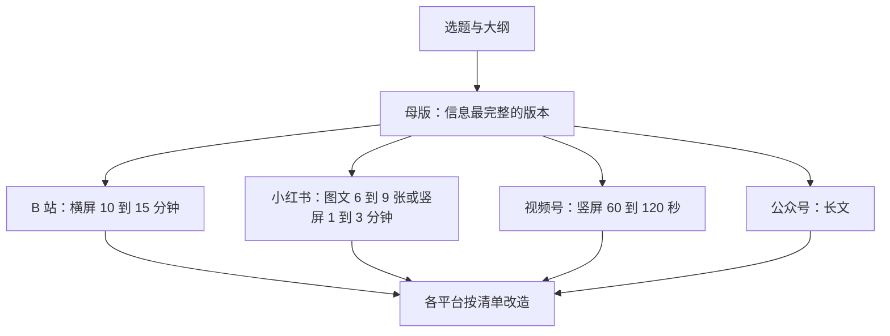
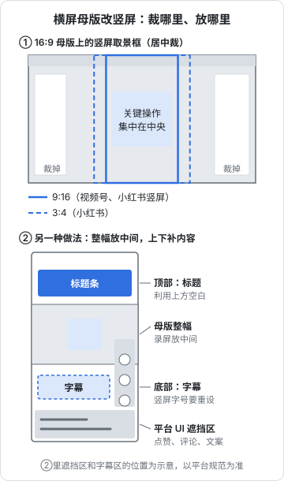

# 一份内容，多平台分发

主平台跑通以后，自然会想：同一个主题，能不能在其他平台也发一遍？可以，但不能原样搬。第 1 章那个「三平台同步发一条横屏录屏」的反例说明，每个平台的读者、界面和习惯都不一样，同一份素材要**改造**以后再发。

这一章给一套改造方法：先确定母版，再按平台清单逐项改。

## 什么时候开始多平台分发

不要一开始就做。满足以下条件再考虑：

- [ ] 主平台已经稳定更新 3 个月以上，没有断更
- [ ] 你有一套固定的制作流程，单条内容耗时稳定
- [ ] 每周还能多出 1–2 小时
- [ ] 你知道主平台上哪一类内容表现最好

如果主平台都还没稳定，多平台只会把精力摊薄。

## 母版思路

多平台分发的核心是：**做一份信息最完整的母版，其他平台的版本从母版裁剪和改造出来**。



母版选什么，取决于你的主平台：

| 主平台 | 母版 | 派生 |
|---|---|---|
| B 站 | 横屏中长视频 + 讲稿 | 小红书图文（结论和步骤）、视频号竖屏（最核心的一段） |
| 小红书 | 图文笔记 + 详细正文 | 视频号图片轮播、公众号长文（展开正文） |
| 视频号 + 公众号 | 公众号长文 | 视频号竖屏（结论）、小红书图文（要点） |

经验法则：**从长到短容易，从短到长难**。长内容里有足够的素材可以剪出短版本；短内容扩展成长内容几乎等于重做。所以如果主平台是 B 站，多平台分发最省力。

## 改造清单

每个派生版本都要逐项检查以下维度：

### 画幅

| 平台 | 推荐画幅 | 从横屏母版改造 |
|---|---|---|
| B 站 | 16:9 横屏 | 母版本身 |
| 小红书视频 | 3:4 或 9:16 竖屏 | 重新构图：录屏放中间，上下加标题条和字幕；或只截取关键区域放大 |
| 视频号 | 9:16 竖屏为主 | 同上 |
| 小红书图文 | 3:4 | 从视频里截关键帧，配大字做成卡片 |

**横屏直接放进竖屏框、上下大片黑边**，是最常见的偷懒做法，在竖屏流里显示面积小，点击和完播都差。至少要把上下空白利用起来：顶部放标题，底部放字幕。

录屏类内容的竖屏改造技巧：录制时就把关键操作集中在屏幕中央的一块区域，后期裁成竖屏时损失最小。

下图上半部分是在 16:9 母版上叠画的 9:16 和 3:4 取景框，居中裁时两侧都会丢掉；下半部分是另一种做法，母版整幅放在竖屏中间，顶部放标题、底部放字幕，字幕要避开平台界面的遮挡。



### 时长

| 平台 | 派生版本时长 | 剪什么 |
|---|---|---|
| B 站 | 10–15 分钟（母版） | — |
| 视频号 | 60–120 秒 | 只保留开头结论 + 最核心的一步演示 + 结尾 |
| 小红书视频 | 1–3 分钟 | 结论 + 关键步骤，每步更短 |
| 小红书图文 | — | 不剪视频，提炼成 6–9 张卡片 |

剪短版本时，不要从母版里截一段连续的片段，而是**重新组织**：短版本要有自己的开头钩子和结尾。

### 标题

同一个主题，三个平台的标题写法不同：

| 平台 | 标题例子 | 写法要点 |
|---|---|---|
| B 站 | 「10 分钟在本地跑起代码库问答助手｜Ollama + 开源 Embedding 完整教程」 | 长，包含技术名词，说清是完整教程 |
| 小红书 | 「程序员必备！本地 AI 助手，代码库随便问」 | 短，关键词靠前，场景化 |
| 视频号 | 「不用联网，AI 帮你读懂整个代码库」 | 说清对观众的好处，避免太多术语 |

注意小红书标题里不要用「必备」「神器」这类绝对化表达过度，上面例子里的「必备」属于常见用法，但如果在商业合作笔记里使用要更谨慎，见[《自媒体与短剧合规财税》](../media-compliance/)。

### 封面

| 平台 | 比例 | 要点 |
|---|---|---|
| B 站 | 16:9 | 大字 + 画面主体，缩小可读 |
| 小红书 | 3:4 | 大字 6–12 字，一件事 |
| 视频号 | 视频号的封面比例以发布页为准，竖屏视频通常为竖版 | 可以和小红书共用版式，调整尺寸 |

三个平台的封面**用同一套视觉风格**（字体、配色），但尺寸和文字要分别做。

### 标签与话题

| 平台 | 数量 | 选法 |
|---|---|---|
| B 站 | 5–10 个标签 | 技术名词 + 内容类型 + 场景 |
| 小红书 | 3–5 个话题 | 和搜索关键词一致 |
| 视频号 | 2–3 个话题 | 和内容相关的通用话题 |

### 字幕和画面文字

- **竖屏版本一定要有字幕**：视频号、小红书很多人静音刷
- **字号要按竖屏重新设定**：横屏母版里的字幕，裁成竖屏后可能太小
- **术语加注释**：视频号观众未必懂「Embedding」，第一次出现时加一句白话解释

### 平台水印和元素

- **去掉其他平台的水印和元素**：带着 B 站水印、抖音水印发到小红书或视频号，会被识别为搬运（即使是你自己的内容），可能影响分发甚至判定违规。**用剪辑软件导出的无水印原片发布**
- **不要出现「关注我的 B 站」「去小红书搜我」**这类跨平台导流的口播或字幕，多数平台都把引导到其他平台列为违规或不鼓励（小红书的《交易导流违规管理细则》明确包括其他平台账号信息）
- 结尾的「关注」「三连」引导按当前平台的习惯说：B 站说「三连」，其他平台说「关注」

### 原创声明和 AI 标识

- 每个平台都按该平台的方式**分别声明原创**（自己的内容才声明）
- 每个平台都按该平台的方式**分别做 AI 内容标识**（如适用）
- 同一内容在多个平台发布不算搬运，但要确保每个版本都是你自己从原片导出的

## 改造清单（可复制）

```text
母版：______（平台 / 形态 / 时长）
派生平台：______

□ 画幅：改为 ____，上下空白已利用（标题条 / 字幕）
□ 时长：剪到 ____ 秒 / 分钟，有独立的开头钩子和结尾
□ 标题：按该平台写法重写，包含关键词 ____
□ 封面：按该平台比例重做，风格与母版一致
□ 标签 / 话题：____ 个，已按平台习惯选择
□ 字幕：竖屏字号已调整，术语加了白话解释
□ 水印：使用无水印原片，无其他平台标识
□ 口播 / 字幕中无跨平台导流
□ 结尾引导按平台习惯（三连 / 关注）
□ 原创声明：已勾选（仅原创内容）
□ AI 标识：已按平台要求标注（如适用）
□ 发布时间：按该平台后台的粉丝活跃时间
```

## 完整示例：一期内容的三个版本

母版：B 站 12 分钟教程「用本地大模型给自己的笔记库做问答」。

```text
【B 站母版】横屏 12 分钟
标题：本地大模型 + 笔记库问答｜Ollama 完整搭建教程，数据不出电脑
章节：00:00 效果演示 / 00:40 环境准备 / 03:10 导入笔记 / 07:20 提问与调参 / 10:30 常见报错 / 11:30 总结
标签：Ollama、本地大模型、知识库、教程、效率工具、Mac

【视频号版】竖屏 90 秒
开头 3 秒：直接放提问画面，「我问它去年记的读书笔记，它答出来了。」
中段：只保留「导入笔记 → 提问」两步，录屏区域放大到竖屏中央，上方标题条，下方字幕
结尾：「完整搭建步骤我写成了公众号文章。」挂公众号文章
文案：用 AI 给自己的笔记做个问答助手，数据不出电脑 #AI工具 #效率

【小红书图文】7 张 3:4 卡片
封面大字：笔记库变成 AI 问答助手
图 2：效果截图；图 3–5：三步搭建（每步一张，截图 + 关键命令）
图 6：常见报错 3 个；图 7：适合谁 / 电脑配置要求
标题：本地大模型做笔记问答｜Mac 上 3 步搭好
正文：首段说场景和结论，中段写命令文字版，结尾问「你的笔记都存在哪」
话题：#本地大模型 #AI工具 #笔记 #效率
```

三个版本共用同一批素材（录屏、截图、讲稿），但开头、长度、标题、结尾引导都按平台重新做过。额外耗时：视频号版约 1 小时，小红书版约 1 小时。

## 发布顺序和节奏

### 先发主平台

主平台优先发布，其他平台间隔一到几天再发。理由：

- 主平台的数据最重要，要第一时间关注和回复评论
- 主平台的评论和弹幕可能暴露问题（讲错、没讲清），在派生版本里改掉
- 错开发布，你每天的回复评论工作量更平均

### 一周的排期示例

以 B 站为主平台、每两周一条中长视频为例：

| 天 | 动作 | 耗时 |
|---|---|---|
| 周六 | 录制母版 | 3 小时 |
| 周日 | 剪辑母版，B 站发布 | 3 小时 |
| 周一–周二 | 回复 B 站评论和弹幕，记录问题 | 每天 15 分钟 |
| 周三 | 从母版剪视频号竖屏版，发布 | 1 小时 |
| 周四 | 从母版截图做小红书图文，发布 | 1 小时 |
| 下周 | 选下一期题目、准备环境 | 2 小时 |

两周总计约 11–12 小时，每周约 6 小时。

## 数据怎么对比

多平台分发以后，不要用同一个标准比较各平台的数据：

| 平台 | 主要看 | 不要比 |
|---|---|---|
| B 站 | 平均观看时长、投币、收藏、搜索流量 | 不要和视频号比播放量 |
| 小红书 | 收藏、搜索流量占比、关注转化 | 不要和 B 站比时长 |
| 视频号 | 转发、推荐、带到公众号的阅读 | 不要和小红书比收藏 |

每个月看一次：**派生平台的投入产出是否值得继续**。如果某个派生平台三个月都没有起色，而且占用了你每周 1–2 小时，停掉它，把时间还给主平台。

## 常见坑

- **横屏原片直接塞进竖屏框**：上下黑边，显示面积小
- **带着其他平台的水印发布**：被识别为搬运，影响分发
- **口播里说「B 站搜我」**：跨平台导流，在多个平台都有违规风险
- **所有平台同一天发**：没时间看主平台的反馈，回复评论忙不过来
- **用同一个标准比较各平台数据**：得出「视频号不行」「B 站播放太少」之类的错误结论
- **使用一键多平台分发工具后不检查**：不同平台的标题字数、封面比例、话题格式都不一样，自动分发常常显示错乱；第三方工具是否符合各平台的开放接口规则也需要自行确认，见[《给创作者和短剧团队做工具》](../creator-tools/)

## 本章要点

- 主平台稳定 3 个月以上、每周有余力，才开始多平台分发
- 做一份信息最完整的母版，其他版本从母版改造；从长到短容易，B 站主平台最适合
- 改造清单：画幅、时长、标题、封面、标签、字幕、水印、跨平台导流、原创声明、AI 标识、发布时间
- 竖屏版本要重新构图、独立的开头和结尾、必须有字幕
- 用无水印原片发布，不在内容里引导去其他平台
- 主平台先发，派生平台错开；每个平台用自己的指标判断，三个月没起色就停
