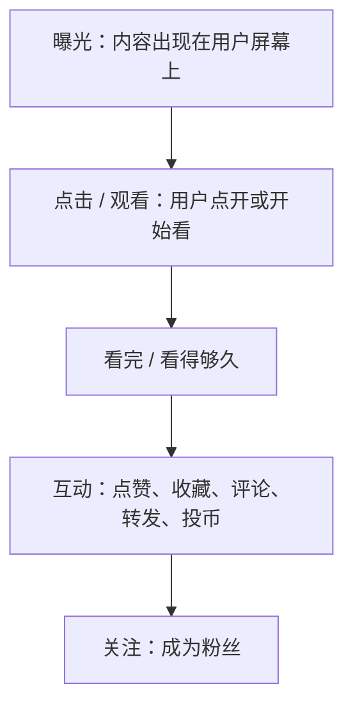
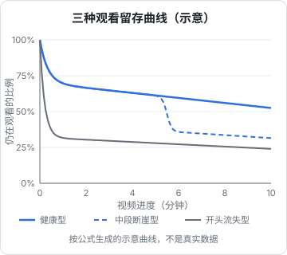

# 创作者后台数据怎么看

三个平台都给创作者提供了数据后台：小红书的创作中心（专业号数据中心）、微信的视频号助手、B 站的创作中心。后台里的数字很多，但真正影响决策的只有几个。这一章讲每个平台的后台里该看什么、怎么算、怎么用数据诊断问题，并给出一份每周复盘模板。

付费推广（薯条、视频号加热、B 站的推广工具）的数据分析和 ROI 计算见[《投流与数据分析》](../paid-traffic/)，这里只讲自然流量。

## 先说几条通用原则

### 后台的指标名称会变

三个平台的后台都在不断改版，指标名称、位置、口径都会调整。**本章用的是通用的概念名称**（曝光、点击率、平均观看时长……），具体在后台里叫什么、怎么计算，以后台指标旁的说明（通常是一个问号图标或悬浮提示）为准。

我没有找到三个平台对「曝光」「点击率」等指标的公开官方定义文档，下面的计算口径是行业通用理解。

### 看趋势，不看单篇

- 前 20 篇内容的数据波动很大，单篇数据说明不了什么
- 至少用 **4 周滚动平均** 看趋势
- 和**自己过去的数据**比，不要和别人的爆款比

### 样本量太小时不要下结论

一篇笔记曝光 200、点击 10，点击率 5%；另一篇曝光 200、点击 16，点击率 8%。差了 6 次点击，不足以说明哪个封面更好。经验上，**曝光在几千以上、对比的差异持续出现在多篇内容里**，才值得据此调整做法。

## 一条内容的漏斗

无论哪个平台，一条内容从发布到带来关注，都经过类似的漏斗：



每一层对应一个比率：

| 环节 | 指标 | 计算 | 主要受什么影响 |
|---|---|---|---|
| 曝光 → 点击 | 点击率 | 点击数 ÷ 曝光数 | 封面、标题 |
| 点击 → 看完 | 完播率 / 平均观看时长占比 | 平均观看时长 ÷ 视频时长 | 开头、节奏、内容质量 |
| 看完 → 互动 | 互动率 | 互动数 ÷ 观看数 | 内容价值、互动引导 |
| 互动 → 关注 | 涨粉率 | 新增关注 ÷ 观看数 | 账号定位清晰度、主页 |

诊断问题时，**找漏斗里最差的那一层**，先改它。

## 小红书后台

### 看哪些数据

小红书专业号的数据中心通常包括账号整体数据、单篇笔记数据和粉丝数据（以当前后台为准）。重点看：

| 指标 | 说明 | 怎么用 |
|---|---|---|
| 曝光 | 笔记被展示的次数 | 平台给了多少机会 |
| 观看 / 阅读 | 点开笔记的次数 | — |
| 点击率 | 观看 ÷ 曝光 | 封面标题的效果 |
| 人均观看时长 | 每位用户在笔记上平均停留的时间 | 视频笔记看完播，图文看有没有翻完 |
| 点赞、收藏、评论、分享 | 互动 | 收藏是工具类内容最重要的信号 |
| 新增关注 | 这篇笔记带来的关注 | — |
| 流量来源 | 首页推荐、搜索、关注页、个人主页等 | 判断笔记属于哪条通道（第 2 章） |

### 两个自己算的比率

**收藏 / 点赞比**：

$$
\text{收藏点赞比} = \frac{\text{收藏数}}{\text{点赞数}}
$$

工具、教程、清单类内容，收藏数接近或超过点赞数，说明读者觉得「以后用得上」。观点、情绪类内容点赞高于收藏是正常的。

**涨粉率**：

$$
\text{涨粉率} = \frac{\text{新增关注}}{\text{观看数}}
$$

有行业文章给出的参考是 1% 合格、2% 优秀、低于 0.5% 说明缺少关注引导（来源：人人都是产品经理上的创作者经验文章，**非官方标准**）。这个数字只适合用来和你自己的历史数据对比。

### 小红书的诊断表

| 现象 | 可能原因 | 动作 |
|---|---|---|
| 曝光很低（几百以内且不增长） | 新号权重低、内容被判定为低质或违规、标签不准 | 检查是否有违规通知（第 10 章）；检查领域是否垂直 |
| 曝光正常，点击率低 | 封面看不清、标题没吸引力 | 改封面：大字更少更大；标题更具体 |
| 点击率正常，收藏低 | 内容不够实用，或信息密度低 | 增加清单、模板、步骤类信息 |
| 收藏高，关注低 | 读者觉得这篇有用，但不知道你还能提供什么 | 主页栏目化；简介写清更新内容 |
| 搜索流量占比长期很低 | 标题和正文缺少搜索词 | 回到关键词表（第 2 章） |

## 视频号助手

### 看哪些数据

视频号助手（网页版和 App）提供单条视频数据和账号数据（以当前后台为准）。重点看：

| 指标 | 说明 | 怎么用 |
|---|---|---|
| 播放量 | — | 基础 |
| 完播率 / 平均播放时长 | 看完的比例或平均看了多久 | 开头和节奏 |
| 推荐（点赞） | 观众点「推荐」的次数 | 社交推荐链条的启动 |
| 转发 | 被转发到聊天、群聊、朋友圈的次数 | 视频号最重要的传播指标 |
| 评论 | — | — |
| 新增关注 | — | — |
| 流量来源 | 关注、朋友（社交推荐）、推荐、分享、搜索等 | 判断内容靠什么传播 |

### 视频号的核心比率：转发率

$$
\text{转发率} = \frac{\text{转发数}}{\text{播放量}}
$$

在视频号上，转发比点赞更能说明内容的传播力（第 4 章）。对比你自己的视频，**转发率最高的那一类内容，就是视频号上最该多做的**。

### 社交流量占比

看流量来源里「朋友」（社交推荐）和「分享」带来的播放占比：

- **社交占比高、推荐占比低**：内容在熟人圈子里传得动，但算法没有放大；可能是完播率不够，或者内容圈子太窄
- **推荐占比高、社交占比低**：算法认可，但观众不愿公开推荐或转发；检查内容是否「让人不好意思推荐」
- **两者都低**：主要靠关注者在看，冷启动没有打开

### 视频号的诊断表

| 现象 | 可能原因 | 动作 |
|---|---|---|
| 播放几乎只来自好友 | 冷启动依赖自己的社交圈，内容没出圈 | 做更普适的选题；改善开头留人 |
| 播放还行，转发很少 | 内容「好看但不值得转」 | 增加实用性：对朋友或家人有用 |
| 完播率低 | 开头没留住人、视频太长 | 前 3 秒给结论；压缩到 90 秒内 |
| 公众号文章阅读没被带起来 | 视频里没有给出点进文章的理由 | 结尾明确「完整模板在文章里」 |

## B 站创作中心

### 看哪些数据

B 站创作中心提供稿件数据、粉丝数据和收益数据（以当前后台为准）。重点看：

| 指标 | 说明 | 怎么用 |
|---|---|---|
| 播放量 | — | 基础 |
| 封面点击率 | 推荐展示后被点击的比例（如后台提供） | 封面标题效果 |
| 平均播放时长 / 观看完成度 | — | 内容质量 |
| 观看留存曲线（如后台提供） | 每个时间点还有多少比例的观众在看 | 找出流失点 |
| 点赞、投币、收藏、分享 | 互动；投币和收藏是高价值认可 | — |
| 弹幕、评论 | 互动和反馈 | 回看弹幕内容 |
| 流量来源 | 推荐、搜索、相关推荐、关注动态、站外等 | 判断长期流量结构 |
| 新增粉丝 | — | — |

### 留存曲线：中长视频最有用的图

如果后台提供了观看留存曲线（每个时间点仍在观看的观众比例），它是改进中长视频最有用的工具。常见的三种形态：



| 曲线形态 | 说明 | 动作 |
|---|---|---|
| 健康型：开头小幅下降，之后平缓 | 开头筛掉了不感兴趣的人，留下的人一直在看 | 保持 |
| 开头流失型：前 30 秒大幅下滑 | 开头没留住人 | 删片头、前 10 秒给结论 |
| 中段断崖型：某个时间点突然下跌 | 这个位置有问题：讲得拖沓、插了广告、画面看不清 | 回看这个时间点的视频和弹幕 |

几个细节：

- 曲线上的**小幅回升**通常表示观众拖回去重看了某一段，那一段可能是精华，也可能是没看懂；结合弹幕判断
- 商单视频在广告位置出现明显下跌是正常的，但如果跌得太深，说明广告太长或太突兀

### 互动率的计算

B 站常用「三连率」类的指标衡量内容质量：

$$
\text{投币率} = \frac{\text{投币数}}{\text{播放量}}, \quad \text{收藏率} = \frac{\text{收藏数}}{\text{播放量}}
$$

同样只和自己的历史数据比。技术教程类视频通常收藏率较高（观众存起来以后跟着做），观点类视频评论和弹幕较多。

### B 站的诊断表

| 现象 | 可能原因 | 动作 |
|---|---|---|
| 推荐流量低、点击率低 | 封面标题问题 | 封面字更少更大；标题加具体技术名词 |
| 点击率正常、留存在开头大幅下跌 | 开头有问题 | 删片头、前 10 秒给结论 |
| 留存在中段某处断崖 | 那一段有问题 | 回看该时间点和弹幕 |
| 播放高、投币收藏低 | 内容有趣但不够有价值 | 增加干货密度 |
| 搜索流量占比低 | 标题标签缺搜索词，或选题没人搜 | 回到选题方法（第 7 章） |

## 每周复盘模板

每周花 30 分钟，填一张表：

```text
复盘周期：____ 年 __ 月 __ 日 – __ 月 __ 日
主平台：____

一、本周发布（每条内容记一组）
- 内容：____  发布日：____
  曝光：____  点击率：____  平均观看 / 完播：____
  收藏或投币：____  转发：____  新增关注：____
  主要流量来源：____

二、4 周滚动对比（本周 vs 前 4 周平均）
- 点击率：____ → ____
- 平均观看 / 完播：____ → ____
- 新增关注：____ → ____
- 搜索流量占比：____ → ____

三、本周最好和最差的一条
- 最好：____，好在哪一层漏斗？____
- 最差：____，差在哪一层漏斗？____

四、下周只改一件事
- ____（例：封面大字从 15 字减到 8 字）
```

这是复盘时要填写的文本模板，可以直接复制到你的笔记软件里。

**每周只改一件事**：同时改封面、标题、开头和时长，下周数据变好或变坏，你都不知道是哪个改动起了作用。

## 粉丝画像

三个平台都提供粉丝的性别、年龄、地域、兴趣等画像（以后台为准）。用法：

- **验证定位**：你想写给 25–35 岁的开发者，画像里却是 18–24 岁的学生居多，说明内容实际吸引的人和你设想的不一样。要么调整内容，要么接受并调整定位
- **商单报价的依据**：品牌方会看粉丝画像，详见[《广告商单与品牌合作》](../brand-deals/)
- **发布时间**：后台的粉丝活跃时段可以作为发布时间参考，前 8 周固定时间发布，再按数据调整

## 常见坑

- **每天刷后台看数据**：数据有延迟、波动大，频繁看只会焦虑；每周复盘一次足够
- **用单篇爆款决定方向**：一篇爆了可能是运气，三篇同类都比平均好才说明是方向
- **只看播放量和粉丝数**：在三个平台上，收藏、转发、投币、搜索流量更能说明内容是否在长期工作
- **一次改多个变量**：无法知道是什么起了作用
- **用第三方数据工具时授权账号**：部分第三方工具需要账号授权或登录，存在账号安全和违规风险；优先使用平台官方后台

## 本章要点

- 指标名称和口径以后台说明为准；看 4 周趋势，和自己比，样本小时不下结论
- 一条内容的漏斗：曝光 → 点击 → 看完 → 互动 → 关注，找最差的那一层先改
- 小红书重点看点击率、收藏点赞比、搜索流量占比；视频号重点看转发率和社交流量占比；B 站重点看留存曲线、投币和收藏
- 留存曲线有健康型、开头流失型、中段断崖型三种形态，分别对应保持、改开头、查那个时间点
- 每周 30 分钟复盘，每周只改一件事
- 粉丝画像用来验证定位、支撑商单报价、参考发布时间
