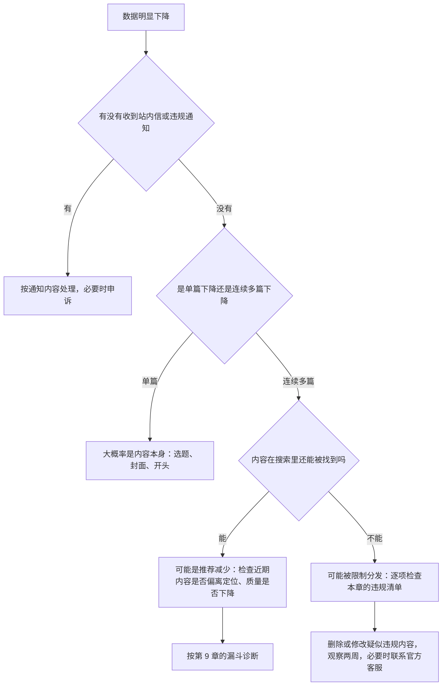

# 违规与限流

做内容最怕的不是数据差，而是辛苦做的内容被删、账号被限流甚至封禁。这一章整理三个平台上创作者最常见的违规原因，讲怎么区分「被限流」和「正常的数据波动」，以及出了问题怎么排查和申诉。

[《国内私域与内容平台》第 9 章](../private-domain-cn/09-rules-and-bans.md)从产品引流的角度讲过平台规则的三层结构、高风险行为清单、广告法底线和申诉流程，本章不重复那些通用内容，只聚焦**内容创作者**的高频问题。法律层面的广告标注、版权、肖像、AI 标识、未成年人保护等，详见[《自媒体与短剧合规财税》](../media-compliance/)。

**说明**：本章讲这些行为是为了让你避开风险。刷量、搬运、规避审核的具体做法，本书不讲。

> [!WARNING]
> 本章的平台规则和法规按截至 2026-11 的公开资料整理，各处标了发布时间，规则会持续调整；以小红书规则中心、视频号运营规范、B 站社区公约 / 创作中心的最新原文，以及网信办的规定原文为准。

## 先分清：是限流还是正常波动

很多创作者把数据下降都归结为「被限流」。其实大部分时候是正常波动或内容本身的问题。

### 判断流程



### 几个自查方法

| 方法 | 怎么做 | 说明 |
|---|---|---|
| 看通知 | 检查站内信、系统通知、创作中心的违规记录 | 平台对明确违规的处罚通常会通知 |
| 看账号状态 | 部分平台在创作中心有账号状态或健康度入口 | 以当前后台功能为准 |
| 搜自己 | 用另一个账号（家人的手机）搜你的笔记标题或账号名 | 搜不到可能是被限制，也可能是索引延迟 |
| 看流量来源 | 对比最近几篇和之前的流量来源结构 | 推荐来源突然消失但搜索还在，说明问题在推荐侧 |

小红书的情况，有行业文章提到：平台对限流一般会有系统通知，但多数情况下不会直接告知，需要结合后台提醒和数据表现自己排查（来源：干货库等行业文章，经验说法）。

**不要相信付费的「查权重」「解限流」服务**。这类服务通常没有任何平台数据权限，只会收钱，有的还要你授权账号登录，带来盗号风险。

## 三个平台共有的高风险行为

### 一、导流到站外

> [!WARNING]
> 小红书导流细则按 2025-03-12 起施行的版本整理，可能已修订，以小红书规则中心的细则原文为准。

三个平台都不允许在内容里留联系方式、引导去其他平台交易。

- **小红书**：2025 年 3 月 12 日起施行的《交易导流违规管理细则》禁止传播个人或社群联系方式、其他平台账号或店铺信息；禁止发布其他平台的链接、口令、截图、水印、二维码、小程序，包括直接、变形或植入的形式；禁止多账号配合引导。处罚从警告、限流到暂时或永久封禁账号（来源：光明网 2025-03-12 转载小红书官网细则）
- **视频号**：主页和直播间配置「添加企业微信」的功能已不对新配置开放（见[《国内私域与内容平台》第 4 章](../private-domain-cn/04-wechat-oa-channels.md)）；其他导流规则以视频号运营规范为准
- **B 站**：站外导流的具体条款以社区公约和创作中心规则为准；社区对营销导流本来就反感

常见的「变形」做法，例如谐音、拆字、图片里藏微信号、评论区让小号「求链接」，在小红书的细则里明确列为违规。具体怎么合规地让用户找到你，见[《国内私域与内容平台》](../private-domain-cn/)第 3、4 章。

### 二、搬运和非原创

| 行为 | 风险 |
|---|---|
| 把别人的视频下载后重新发布 | 侵权 + 违规，三个平台都打击 |
| 别人的视频简单剪辑、加滤镜、镜像、变速后发布 | 同上；这些「伪原创」处理方式平台都在识别 |
| 把别人的文章做成图文笔记，不注明出处 | 侵权 |
| 自己的内容带着其他平台水印发布 | 可能被识别为搬运（第 8 章） |
| 非原创内容声明原创 / 选「自制」 | 违规，可能被取消原创权限或激励资格 |

引用他人内容时：只引用必要的片段，注明出处，加入你自己的评论和分析。是否构成合理使用是法律问题，见《自媒体与短剧合规财税》。

### 三、AI 内容不标识或滥用 AI

> [!WARNING]
> 本节按 2025-09-01 施行的《人工智能生成合成内容标识办法》和小红书 2026-02、2026-04 的公告整理，可能已调整，以网信办规定原文和各平台规则中心的最新公告为准。

国家《人工智能生成合成内容标识办法》2025 年 9 月 1 日起施行，各平台都在落实标识要求。

小红书的规则最具体（2026 年）：

- 2026 年 2 月 12 日公告：未主动标识的 AI 生成合成内容，平台将限制分发；平台识别后会统一添加标识；同时打击教人去除 AI 标识的内容（来源：澎湃新闻 2026-02-13 报道）
- 2026 年 4 月 27 日发布的 AI 内容治理规则，列出四类违规（来源：科技日报、IT 之家 2026-04-27 报道）：

| 类型 | 包括 |
|---|---|
| AI 违规运营 | 用 AI 自动运营账号、冒充真人互动、传授 AI 洗稿或规避审核的方法 |
| AI 造假 | 克隆他人声音或面孔、以虚假人设种草、伪造经历和截图、制造涉及公共事件的虚假内容 |
| AI 侵权 | 未经授权生成他人可识别的肖像、模仿受版权保护的作品 |
| AI 低质 | 模板化批量生产同质化内容、用猎奇画面博眼球、传播极端不良价值观 |

处置方式按情节轻重包括限制分发、封禁账号；明显由 AI 运营、没有真人参与的账号会被直接封禁。平台同时表示，对非违规内容，AI 标签不影响流量。

视频号、B 站的 AI 标识规则以各自的发布页和社区规范为准。原则一样：**用了 AI 就标，不用 AI 冒充真人，不批量生产同质内容**。

### 四、刷量和数据造假

| 行为 | 说明 |
|---|---|
| 买粉、买赞、买收藏、买播放 | 违反三个平台的社区规范 |
| 互赞群、互粉群 | 有组织的互刷同样属于数据造假 |
| 多账号给自己的内容互动 | 小红书细则明确打击多账号配合 |
| 找人刷评论、控评 | 同上 |

除了违规风险，刷量还会**污染你的数据**：刷来的点赞让算法以为内容受某类人群欢迎，把后续内容推给错误的人，自然数据反而更差。第 9 章的所有诊断都会失效。

### 五、未报备的商业合作

- 小红书：品牌合作应通过蒲公英，合作笔记带官方标识；行业报道称 2025 年起小红书重点打击违规营销，即使通过蒲公英下单，内容造假仍会被认定为违规营销（来源：行业媒体报道，具体规则以官方公告为准）
- 视频号：品牌合作可通过互选平台
- B 站：品牌合作可通过花火平台

私下接单不标注，既可能违反平台规则，也可能违反《互联网广告管理办法》关于广告可识别性的要求。详见[《广告商单与品牌合作》](../brand-deals/)《自媒体与短剧合规财税》。

### 六、违法和违规内容表述

| 类型 | 例子 | 说明 |
|---|---|---|
| 绝对化用语 | 「最好」「第一」「神器」「100% 有效」 | 《广告法》限制，商业内容中风险最高 |
| 需要资质的领域 | 医疗健康建议、投资理财推荐、法律意见 | 非专业资质创作者不要提供具体建议 |
| 虚假宣传 | 夸大的收入截图、编造的使用效果 | 涉嫌虚假宣传；复盘类内容尤其要真实 |
| 未成年人相关 | 未成年人出镜、面向未成年人的营销 | 有专门的保护规定 |
| 侵犯隐私 | 截图中有他人手机号、聊天记录、人脸 | 发布前打码 |

开发者特别要注意的一类：**收入截图和「月入几万」的副业内容**。如果是真实的，注意隐去敏感信息；如果不是，别发。各平台对夸大收入、贩卖焦虑类内容都在治理。

### 七、版权素材

- **音乐**：使用平台音乐库里的音乐；自己从网上下载的音乐可能侵权
- **字体**：封面、字幕用的字体也有版权，商用字体需要授权，优先用免费可商用字体
- **图片**：不要直接用网上搜到的图片；用自己拍的、自己截图的，或有明确授权的素材
- **软件界面截图**：一般用于评测和教程是常见做法，但不要截取含他人隐私或保密信息的界面

细节见[《拍摄与剪辑实务》](../shooting-editing/)《自媒体与短剧合规财税》。

## 各平台的特别注意事项

### 小红书

- 导流细则覆盖笔记、评论、私信、用户资料、直播等位置，私信里也不要发联系方式
- 专业号后台的自动回复、欢迎语里不能出现微信号和电话（2025 年 1 月起，见[《国内私域与内容平台》第 3 章](../private-domain-cn/03-xiaohongshu.md)）
- 商业笔记必须通过蒲公英；蒲公英的账号健康等级会影响接单

### 视频号

- 视频号和你的微信账号是同一个，严重违规可能影响的不只是视频号
- 直播时的规则比短视频更严，直播前看一遍视频号直播的相关规范
- 医疗、理财、保健品等内容在视频号上（中老年用户多）监管尤其严

### B 站

- 投稿的「自制 / 转载」选择要如实
- 知识区、科技区对专业性要求高，误导性的技术内容可能被用户举报
- B 站曾提醒「付费代认证」是诈骗高发场景（见[《国内私域与内容平台》第 5 章](../private-domain-cn/05-douyin-bilibili.md)），不要找人代办认证

## 出了问题怎么办

### 内容被删或被判违规

```text
1. 截图保存通知内容，记下时间
2. 对照通知说的违规类型，找到内容里的具体问题
3. 判断：
   - 确实违规 → 接受处理，修改同类内容，不要重复
   - 认为误判 → 走平台的申诉入口，写清楚理由
4. 申诉理由的写法：
   - 说明内容是什么、为什么不属于通知所说的违规类型
   - 提供证据：原创素材、授权文件、AI 标识截图等
   - 语气平和，不要情绪化
5. 申诉期间不要发同类内容，不要删号重开
```

### 账号被限制功能或封禁

- 先看清是哪种处罚：限制某个功能（如私信、直播）、限制分发，还是封号；期限多长
- 通过平台的官方申诉渠道申诉；**不要找声称能「内部解封」的第三方**，几乎都是诈骗
- 封号以后重新注册新号继续做同样的事，在多个平台都可能被识别并处罚

### 降低单点风险

- **不要只依赖一个平台**：主平台跑通后，至少在一个辅助平台保持更新（第 8 章）
- **自己保存所有原始素材**：视频工程文件、原图、正文文本，按日期存档
- **建立自己的读者渠道**：公众号、邮件订阅等，在合规前提下让最核心的读者能找到你（见《国内私域与内容平台》[《知识付费与私域变现》](../knowledge-products/)）

## 发布前的违规自查清单

```text
□ 画面、字幕、正文、评论、简介、私信中没有任何联系方式（包括谐音、拆字、图片内嵌）
□ 没有其他平台的水印、账号名、二维码、口令
□ 内容是自己原创的；引用他人内容已注明出处且只引用必要部分
□ 原创声明 / 自制选项如实填写
□ AI 生成或润色的内容已按平台要求标识
□ 没有绝对化用语、虚假宣传、夸大收入
□ 不涉及需要资质的医疗、理财、法律建议
□ 截图已打码：手机号、邮箱、他人头像、聊天记录、公司内部信息
□ 音乐来自平台音乐库；字体和图片有授权
□ 商业合作已通过官方平台并标注
□ 没有买量、互赞、多账号互动
```

## 常见坑

- **把所有数据下降都当成限流**：先排除内容本身的问题
- **花钱「查权重」「解限流」**：没有用，还可能被盗号
- **被判违规后删号重开**：问题没解决，新号也可能被关联处罚
- **觉得「我只是个人号，规则管不到」**：导流、搬运、刷量的规则对所有账号都适用
- **用 AI 批量做号**：2026 年起是小红书明确打击、直接封禁的行为
- **照搬网上的「防限流技巧」**：很多所谓技巧本身就是规避审核，平台在持续识别和打击

## 本章要点

- 数据下降先看有没有违规通知，再区分单篇还是连续多篇、搜索里还能不能找到，大部分下降是内容问题而不是限流
- 三个平台共有的七类高风险：导流、搬运、AI 不标识或滥用、刷量、未报备商单、违法违规表述、版权素材
- 小红书《交易导流违规管理细则》2025-03-12 起施行；2026-02 起未标识的 AI 内容限制分发；2026-04 发布 AI 内容治理规则，AI 托管账号直接封禁
- 被处罚先截图、对照通知找问题，确属误判再走官方申诉；不找第三方解封
- 降低单点风险：辅助平台保持更新、保存原始素材、合规地建立自己的读者渠道
- 每次发布前过一遍违规自查清单
